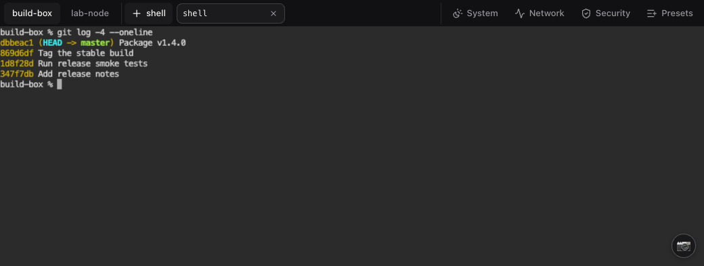
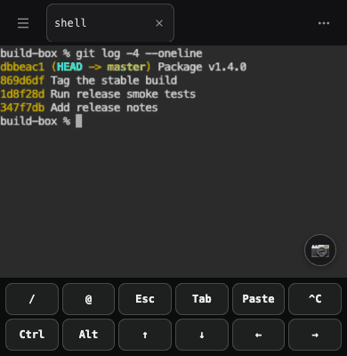

**Languages:** English | [简体中文](README.zh-CN.md)

# shell-gate

**Switch between your servers’ terminals from your phone or laptop.** ShellGate is a self-hosted web terminal for multiple servers. Sign in with a password or passkey, pick a ttyd host, and reopen your saved tabs when you sign in on another device.

[Install](#install) · [Watch the phone demo](#switch-servers-from-your-phone) · [Deployment guide](docs/DEPLOYMENT.md)



## Switch servers from your phone

Open the menu to switch from `build-box` to `lab-node`. Each server has its own tabs, and the mobile shortcut bar keeps Ctrl, Esc, Tab, and arrow keys within reach.



**What comes back after you reconnect?** ShellGate saves your tabs, including the server and launch command. A plain shell opens a new process after disconnecting. To keep a running task, install [tmux](https://github.com/tmux/tmux/wiki/Getting-Started) on the terminal host and run `tmux new-session -A -s work` before starting it. Run the same command on the same server and OS account to reattach while the session is still running. ShellGate doesn't create or manage tmux sessions for you.

## Install

### Start with Docker Compose

Use this route if you don't already run ttyd. It builds and starts a local gateway and a private terminal backend. You need Git and Docker Compose.

```sh
git clone https://github.com/x0c/shell-gate.git && cd shell-gate
cp .env.example .env  # Set SHELL_ALLOWED_EMAILS to your own email.
docker compose up -d --build
```

Create your first invitation using the same email:

```sh
docker compose exec gate shell-gate invite --email you@example.com
```

Open **http://localhost:18765/login**, choose **Set up or recover an account**, and enter your email, invitation code, and a password of at least 12 characters. Choose **Sign in** on return visits. For phone access to a remote deployment, set up [HTTPS](docs/DEPLOYMENT.md#https) and use that hostname. Passkeys are optional and tied to the hostname where you enroll them.

### Connect an existing ttyd host

Install the gateway without Docker. You need a [private ttyd endpoint](docs/DEPLOYMENT.md#direct-binary-and-service).

**macOS / Linux**

```sh
curl -fsSL https://raw.githubusercontent.com/x0c/shell-gate/main/scripts/install.sh | bash
```

```sh
SHELL_ALLOWED_EMAILS=you@example.com SHELL_TTYD_URL=http://127.0.0.1:7681 shell-gate serve
```

**Windows (PowerShell)**

```powershell
irm https://raw.githubusercontent.com/x0c/shell-gate/main/scripts/install.ps1 | iex
```

```powershell
$env:SHELL_ALLOWED_EMAILS='you@example.com'; $env:SHELL_TTYD_URL='http://127.0.0.1:7681'; shell-gate serve
```

In another terminal, use the same environment settings and run `shell-gate invite --email you@example.com`, then open the same localhost login page. If the `shell-gate` command isn't found, add the directory reported by the installer to `PATH`. [Release downloads](https://github.com/x0c/shell-gate/releases/latest) provide checksums and amd64/arm64 binaries for macOS, Linux, and Windows. The Windows gateway connects to a Unix or container terminal backend.

### Add more servers

Set [`SHELL_TTYD_TARGETS`](docs/DEPLOYMENT.md#configuration) to name your private ttyd endpoints. The server picker appears when more than one host is configured.

## Accounts and deployment

- **Sign in locally.** Passwords, optional passkeys, and [authenticator codes](docs/DEPLOYMENT.md#two-factor-authentication) work without an external identity service. The operator controls who can enroll through an email allowlist and single-use invitations.
- **Keep your workspace.** ShellGate stores tabs and saved commands by account in SQLite by default. You can switch themes, use the clipboard, or capture the terminal from the browser.
- **Deploy on your own infrastructure.** The default stack needs no paid service or browser CDN. Downloads and public certificate issuance require internet access. See [deployment](docs/DEPLOYMENT.md) for HTTPS, backups, PostgreSQL, and optional OIDC or GoTrue sign-in. See [architecture](docs/ARCHITECTURE.md) for integration details.

**Trust boundary:** All allowed accounts can open a terminal on every configured host. If two users share an upstream OS account, they share its files, processes, and permissions. Keep ttyd private. Use separate gateway and ttyd stacks with distinct allowlists, domains, and OS accounts or hosts when users need isolation. See [security](SECURITY.md).

## Contribute

See [contributing](CONTRIBUTING.md) for local checks and release packaging. Build from source with Go 1.26.11+ and `go build ./cmd/shell-gate`. ShellGate is [MIT licensed](LICENSE); dependencies retain [their own licenses](THIRD_PARTY_NOTICES.md).

## Related tools

| Project | What it helps with |
| --- | --- |
| [Corral](https://github.com/corral-dev/corral) | Run and manage local coding-agent sessions side by side. |
| [subswap](https://github.com/x0c/subswap) | Check coding-agent quotas and switch accounts without signing out. |
| [agentsync](https://github.com/x0c/agentsync) | Sync skills and configuration across coding agents. |
| [agent-doc-skills](https://github.com/x0c/agent-doc-skills) | Build and maintain a navigable project knowledge base. |
| [sesskit](https://github.com/x0c/sesskit) | Parse and export local coding-agent transcripts. |
