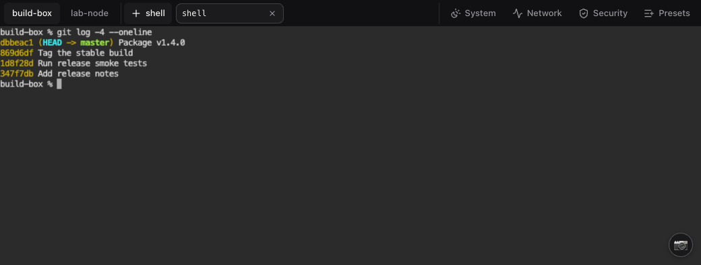
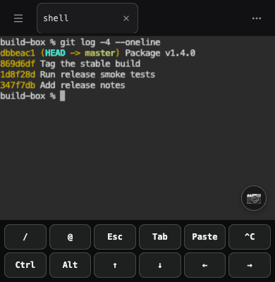

**语言：** [English](README.md) | 简体中文

# shell-gate

**在手机或电脑浏览器里切换多台服务器的终端。** ShellGate 是可以自己部署的网页终端。用密码或通行密钥登录，选一台运行 ttyd 的主机就能开终端；换设备登录后，也能找回已保存的标签页。

[安装](#安装) · [看手机演示](#用手机切换服务器) · [部署说明](docs/DEPLOYMENT.md)



## 用手机切换服务器

打开菜单，就能从 `build-box` 切换到 `lab-node`。每台服务器有各自的标签页，手机底部的快捷键栏可直接点按 Ctrl、Esc、Tab 和方向键。



**断线后能恢复什么？** ShellGate 会保存标签页所属的服务器和启动命令。普通终端断线重连后会启动新的 shell 进程。如果有任务需要继续运行，请在终端主机上安装 [tmux](https://github.com/tmux/tmux/wiki/Getting-Started)，用 `tmux new-session -A -s work` 打开会话，再启动任务。只要会话还在，在同一台服务器上用同一个系统账号运行这条命令，就能接回。ShellGate 不会自动创建或管理 tmux 会话。

## 安装

### 用 Docker Compose 快速试用

如果还没运行 ttyd，用这条路径。需要 Git 和 Docker Compose，会在本机一起构建并启动网关和不对外开放的终端服务。

```sh
git clone https://github.com/x0c/shell-gate.git && cd shell-gate
cp .env.example .env  # 把 SHELL_ALLOWED_EMAILS 改成自己的邮箱。
docker compose up -d --build
```

用同一个邮箱生成邀请码：

```sh
docker compose exec gate shell-gate invite --email you@example.com
```

打开 **http://localhost:18765/login**，选择 **Set up or recover an account**，输入邮箱、邀请码和至少 12 个字符的密码。以后选择 **Sign in** 登录。要用手机访问远程部署，请先配置 [HTTPS](docs/DEPLOYMENT.md#https)，再用该域名访问。通行密钥可按需设置，并绑定到注册时使用的域名。

### 连接已有的 ttyd 主机

可直接安装网关，无须 Docker。请先准备[不对外开放的 ttyd 服务](docs/DEPLOYMENT.md#direct-binary-and-service)。

**macOS / Linux**

```sh
curl -fsSL https://raw.githubusercontent.com/x0c/shell-gate/main/scripts/install.sh | bash
```

```sh
SHELL_ALLOWED_EMAILS=you@example.com SHELL_TTYD_URL=http://127.0.0.1:7681 shell-gate serve
```

**Windows（PowerShell）**

```powershell
irm https://raw.githubusercontent.com/x0c/shell-gate/main/scripts/install.ps1 | iex
```

```powershell
$env:SHELL_ALLOWED_EMAILS='you@example.com'; $env:SHELL_TTYD_URL='http://127.0.0.1:7681'; shell-gate serve
```

在另一个终端使用相同的环境变量运行 `shell-gate invite --email you@example.com`，然后打开上面的本机登录页面。如果找不到 `shell-gate` 命令，把安装器显示的目录加入 `PATH`。[发行下载](https://github.com/x0c/shell-gate/releases/latest)提供 macOS、Linux 和 Windows 的 amd64、arm64 程序及校验和。Windows 上的网关连接 Unix 主机或容器中的终端服务。

### 添加更多服务器

在 [`SHELL_TTYD_TARGETS`](docs/DEPLOYMENT.md#configuration) 中配置每台主机的名称和私有 ttyd 地址。配置两台或更多主机后，工作台会显示服务器切换入口。

## 账号与部署

- **本地登录。** 密码、可选的通行密钥和[两步验证码](docs/DEPLOYMENT.md#two-factor-authentication)无需外部身份服务。管理员用邮箱白名单和一次性邀请码控制谁能创建账号。
- **保留工作台。** 默认使用 SQLite 按账号保存标签页和预置命令。浏览器里还可以切换主题、使用剪贴板或截取终端画面。
- **部署在自己的机器上。** 默认部署不依赖付费服务或浏览器 CDN。首次下载和签发公共证书需要联网。[部署说明](docs/DEPLOYMENT.md)涵盖 HTTPS、备份、PostgreSQL 以及可选的 OIDC 或 GoTrue 登录，[架构说明](docs/ARCHITECTURE.md)提供集成细节。

**权限边界：** 所有获准账号都能打开每台已配置主机的终端。共用终端主机上的同一个系统账号时，用户共享该账号的文件、进程和权限。请勿对外开放 ttyd。需要隔离用户时，请分别部署网关和 ttyd，并使用不同的白名单、域名，以及独立的系统账号或主机。详见[安全说明](SECURITY.md)。

## 贡献

[贡献说明](CONTRIBUTING.md)包含本地检查和发行打包流程。源码构建需要 Go 1.26.11 或更新版本，运行 `go build ./cmd/shell-gate`。ShellGate 使用 [MIT 许可证](LICENSE)，依赖保留[各自的许可证](THIRD_PARTY_NOTICES.md)。

## 相关工具

| 项目 | 用途 |
| --- | --- |
| [Corral](https://github.com/corral-dev/corral) | 并排运行和管理本地编程助手会话。 |
| [subswap](https://github.com/x0c/subswap) | 查看编程助手的剩余额度，不退出登录就能换账号。 |
| [agentsync](https://github.com/x0c/agentsync) | 在不同编程助手之间同步技能和配置。 |
| [agent-doc-skills](https://github.com/x0c/agent-doc-skills) | 建立和维护方便查找的项目知识库。 |
| [sesskit](https://github.com/x0c/sesskit) | 解析和导出本地编程助手的会话记录。 |
