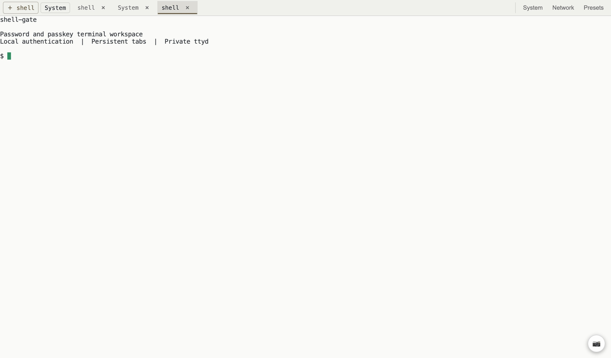

**语言：** [English](README.md) | 简体中文

# shell-gate

在浏览器里打开服务器终端，用邮箱和密码登录，也可以选择通行密钥，并回到已保存的 Tab。ShellGate 是可以自己部署的 Go 终端门禁，支持 ttyd、本地认证、SQLite、多台终端主机和紧凑的手机工作台。



## 安装

**Docker Compose 完整部署**：不需要外部认证服务、数据库服务或浏览器 CDN。

```sh
git clone https://github.com/x0c/shell-gate.git && cd shell-gate
cp .env.example .env  # 把 SHELL_ALLOWED_EMAILS 改成自己的邮箱。
docker compose up -d --build
```

生成第一份邀请：

```sh
docker compose exec gate shell-gate invite --email you@example.com
```

打开 **http://localhost:18765/login**，选择 **Set up or recover an account**，输入邮箱、邀请码和至少 12 个字符的密码。之后点击 **Sign in** 登录；通行密钥是可选方式。部署到其他服务器时，配置 [HTTPS](docs/DEPLOYMENT.md#https)，也可以用 SSH 隧道连接到 localhost。通行密钥绑定域名，请保持访问地址稳定。

**独立门禁程序**：连接已有的私有 ttyd 上游，无须 Docker。

macOS / Linux：

```sh
curl -fsSL https://raw.githubusercontent.com/x0c/shell-gate/main/scripts/install.sh | bash
```

Windows（PowerShell）：

```powershell
irm https://raw.githubusercontent.com/x0c/shell-gate/main/scripts/install.ps1 | iex
```

macOS / Linux 首次运行：

```sh
SHELL_ALLOWED_EMAILS=you@example.com SHELL_TTYD_URL=http://127.0.0.1:7681 shell-gate serve
```

Windows 首次运行：

```powershell
$env:SHELL_ALLOWED_EMAILS='you@example.com'; $env:SHELL_TTYD_URL='http://127.0.0.1:7681'; shell-gate serve
```

在另一个终端使用相同配置运行 `shell-gate invite --email you@example.com`。如有需要，把安装器显示的目录加入 PATH。[发行下载](https://github.com/x0c/shell-gate/releases/latest) 包含校验和，以及三个平台的 amd64、arm64 程序。Windows 运行门禁，终端上游使用 Unix 主机或 Compose 容器。

## 功能

- 本地邮箱密码登录、可选通行密钥、一次性邀请和明确的邮箱白名单。
- 按账号保存 Tab 和预置命令，刷新或换浏览器登录后恢复。
- 多台 ttyd 主机、按机器切换 Tab、记住上次激活的 Tab。
- 紧凑的桌面顶栏、触摸滚动和手机终端快捷键。
- 运行时切换深浅色、剪贴板桥接和终端截图。
- 可选 PostgreSQL、外部 GoTrue 认证及唤醒、保活接口。
- 浏览器资源随程序提供；诊断日志默认关闭。

默认部署运行时不需要远程服务。首次下载需要网络，公共 HTTPS 证书签发也需要网络。隔离环境可预先导入镜像，并自行提供浏览器信任的证书。ShellGate 没有付费服务依赖；服务器、域名及自选服务可能产生费用。

## 部署和配置

[部署说明](docs/DEPLOYMENT.md) 包含 HTTPS、多主机、独立服务、备份和升级；[配置示例](.env.example) 提供初始配置；[架构说明](docs/ARCHITECTURE.md) 描述适配器边界和扩展要求。源码构建需要 Go 1.26.9+，运行 `go build ./cmd/shell-gate`。

**信任边界**：被邀请的人拥有目标终端账号的系统权限。门禁隔离 Tab 和预置数据，不隔离共享系统账号中的文件和进程。所有获准账号都能访问配置中的每台机器。ttyd 必须保持私有；需要用户隔离时，分别部署门禁与 ttyd，使用不同的白名单、域名和系统账号、容器或主机。详见[安全说明](SECURITY.md)。

普通 shell Tab 在重连后恢复启动定义，不保证恢复原来的 shell 进程。自带会话恢复的程序可以自然接回。

## 贡献

请阅读[贡献说明](CONTRIBUTING.md)。本地验证和发行打包不依赖 CI。源码使用 [MIT 许可证](LICENSE)，随程序和容器使用的依赖保留[各自许可证](THIRD_PARTY_NOTICES.md)。
