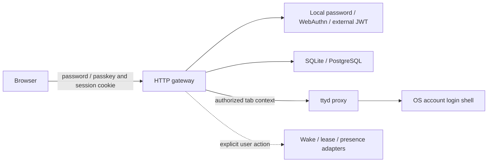

# Architecture

ShellGate is one Go process with embedded browser assets. The default stack is a gateway, its private SQLite directory and a ttyd process. HTTPS termination is optional at localhost and required for remote browser authentication. No remote identity provider, CDN, Redis, database service or private module checkout is required.

## Boundaries

| Capability | Contract | Implementations and invariants |
| --- | --- | --- |
| Token verification | `TokenVerifier.Verify` | Local session and optional external JWT verifier; signature, expiry, issuer, audience and identity required. Local sessions never reuse external access tokens. |
| Password credentials | `internal/auth` + `store.Store` | Salted, bounded Argon2id; invitation-authorized setup/recovery; credential-version-bound sessions, generic sign-in failures and bounded work/rates. |
| Passkey ceremony | `localPasskeys` + WebAuthn library | Origin/RP-bound, user-verified, resident credentials; RAM challenges bounded to 1,024 and five minutes, browser-bound and single-use. Invites authorize enrollment. |
| Durable tabs | `TabRepository` | SQLite and PostgreSQL through `store.Store`; account ownership, explicit errors, stable IDs and atomic audit. |
| Presets and keys | `store.Store` | Transactional SQL provider chosen once on startup. Keep migrations, initial defaults and audit together. Split additional interfaces only when a second consumer needs them. |
| Terminal forwarding | `TerminalBackend` / `http.Handler` | Standard Go ttyd reverse proxy; uses server-owned identity/command context, strips cookies/authorization and refuses environment proxies. |
| Wake and sleep lease | `WakeLocker`, lease hooks | Bounded executable hooks with action/ID arguments; no interpretation of browser text as a shell command. Monitoring cannot initiate wake. |
| Presence policy | Optional HTTP presence adapter | Operator-supplied endpoint and credential; redirects/proxies disabled. Historical wake suppression is fail-open on presence outage and is not an authentication policy. |

`server.go` owns assembly and routing. `session.go` owns cookies and token exchange, `passwords.go` and `passkeys.go` local authentication, `proxy.go` ttyd transport, `tab_handlers.go` and `presets.go` workspace actions, and `diagnostics.go` optional diagnostics. Configuration stays at the process boundary; adapters do not read unrelated environment settings.

## Extending a provider

Implement the smallest existing capability interface. Select it explicitly at startup, validate all mandatory settings before listening, and close resources during shutdown. Do not add a catch-all adapter or silently replace a failed provider. A new terminal adapter must keep account/tab authorization ahead of forwarding and explicitly document its identity-to-OS-account behavior.

Run the same contract against each storage provider: ownership, missing data versus storage failure, rollback on audit failure, initial-default idempotency, invitation consumption and tab persistence. `SHELL_TEST_POSTGRES_URL` runs password and passkey contracts against an isolated test database. New authentication providers require negative signature/origin/expiry tests and a real browser flow. New terminal providers require a real handshake, login-shell commands, Unicode/control characters, reconnect and shutdown checks.

## Failure and isolation

The account owns metadata; the configured upstream OS account owns terminal processes. The machine directory is shared by all allowed accounts; per-account machine authorization is not implemented. Separate gateway/backend stacks and allowlists are required for OS isolation between groups. Plain shell tabs remember their launch definition, not the exact PTY process after reconnect. Programs with their own session recovery can resume naturally. Refresh never invents an extra tab when remembered tabs exist. A failed deletion stays visible. Database failure returns a service error rather than an empty list. Shutdown closes upgraded proxy connections before the database.

Local passkey ceremonies support a single instance and exact public origin. External GoTrue plus shared PostgreSQL supports the existing multi-edge option. This is optional infrastructure, not a prerequisite for standalone use.
