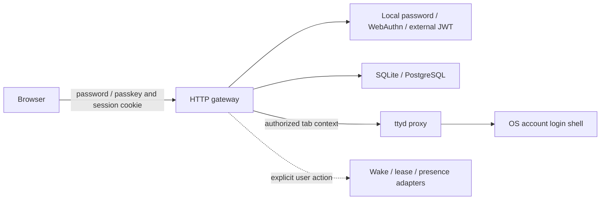

# Architecture

ShellGate is one Go process with embedded browser assets. The default stack is a gateway, its private SQLite directory and a ttyd process. HTTPS termination is optional at localhost and required for remote browser authentication. No remote identity provider, CDN, Redis, database service or private module checkout is required.

## Boundaries

| Capability | Contract | Implementations and invariants |
| --- | --- | --- |
| Token verification | `TokenVerifier.Verify` | Local session and optional external JWT verifier; signature, expiry, issuer, audience and identity required. Local sessions never reuse external access tokens. |
| SSO login | `oidcClient` + `GET /api/sso/login` / `GET /api/sso/callback` | Generic OIDC Authorization Code + S256 PKCE using go-oidc and Go OAuth2. Verify asymmetric signature, exact issuer, audience/authorized party, expiry, subject and nonce before reading identity. UserInfo must match the verified subject; the configured email claim requires boolean `email_verified=true` unless the operator explicitly trusts unverified addresses. Signed browser-bound state; gateway sessions are separate and allowlisted. Provider HTTP rejects redirects, credentials in URLs, oversized bodies and HTTPS downgrade; no environment proxy. |
| Password credentials | `internal/auth` + `store.Store` | Salted, bounded Argon2id; invitation-authorized setup/recovery; credential-version-bound sessions, generic sign-in failures and bounded work/rates. |
| Passkey ceremony | `localPasskeys` + WebAuthn library | Origin/RP-bound, user-verified, resident credentials; RAM challenges bounded to 1,024 and five minutes, browser-bound and single-use. Invites authorize enrollment. |
| Durable tabs | `TabRepository` | SQLite and PostgreSQL through `store.Store`; account ownership, explicit errors, stable IDs and atomic audit. |
| Presets and keys | `store.Store` | Transactional SQL provider chosen once on startup. Keep migrations, initial defaults and audit together. Split additional interfaces only when a second consumer needs them. |
| Terminal forwarding | `TerminalBackend` / `http.Handler` | Standard Go ttyd reverse proxy; uses server-owned identity/command context, strips cookies/authorization and refuses environment proxies. |
| Wake and sleep lease | `WakeLocker`, lease hooks | Bounded executable hooks with action/ID arguments; no interpretation of browser text as a shell command. Monitoring cannot initiate wake. |
| Presence policy | Optional HTTP presence adapter | Operator-supplied endpoint and credential; redirects/proxies disabled. Historical wake suppression is fail-open on presence outage and is not an authentication policy. |

`server.go` owns assembly and routing. `session.go` owns cookies and token exchange, `passwords.go` and `passkeys.go` local authentication, `sso.go` generic OIDC login, `proxy.go` ttyd transport, `tab_handlers.go` and `presets.go` workspace actions, and `diagnostics.go` optional diagnostics. Configuration stays at the process boundary; adapters do not read unrelated environment settings.

## Extending a provider

Implement the smallest existing capability interface. Select it explicitly at startup, validate all mandatory settings before listening, and close resources during shutdown. Do not add a catch-all adapter or silently replace a failed provider. A new terminal adapter must keep account/tab authorization ahead of forwarding and explicitly document its identity-to-OS-account behavior.

Run the same contract against each storage provider: ownership, missing data versus storage failure, rollback on audit failure, initial-default idempotency, invitation consumption and tab persistence. `SHELL_TEST_POSTGRES_URL` runs password and passkey contracts against an isolated test database. New authentication providers require negative signature/origin/expiry tests and a real browser flow. New terminal providers require a real handshake, login-shell commands, Unicode/control characters, reconnect and shutdown checks.

## Failure and isolation

The account owns metadata; the configured upstream OS account owns terminal processes. The machine directory is shared by all allowed accounts; per-account machine authorization is not implemented. Separate gateway/backend stacks and allowlists are required for OS isolation between groups. Plain shell tabs remember their launch definition, not the exact PTY process after reconnect. Programs with their own session recovery can resume naturally. Refresh never invents an extra tab when remembered tabs exist. A failed deletion stays visible. Database failure returns a service error rather than an empty list. Shutdown closes upgraded proxy connections before the database.

Local passkey ceremonies support a single instance and exact public origin. External GoTrue plus shared PostgreSQL supports the existing multi-edge option. Generic OIDC SSO plus shared PostgreSQL also supports multi-edge (callback on the apex, shared-domain session cookie). These are optional infrastructure, not prerequisites for standalone use.

## OIDC adapter review contract

The generic adapter is a confidential web client with Discovery, asymmetric signed ID tokens and `client_secret_basic` or `client_secret_post`. Other client authentication methods, SAML and provider logout are outside this adapter. Issuer identifiers are exact, including a trailing slash. Only the configured email claim is authoritative: do not silently promote a username or UPN into an allowlisted email. UserInfo is consulted only after complete ID-token verification when that claim is absent, and its subject and verification flag must be validated together. An invalid ID token never falls back to UserInfo. Missing subjects, ambiguous multi-audience tokens and mismatched authorized parties fail closed.

The callback state cookie is scoped to the callback path and apex host (no shared cookie domain), expires after ten minutes and is cleared on every callback outcome. Session-key derivation is bound to issuer, client and deployment origin so reusing a client secret does not cross authentication boundaries. Multi-edge instances share those settings and the database. Workspace ownership remains keyed by the allowlisted email, as in the existing adapters; operators must prevent email reassignment at their provider.

Inspected reusable implementations: [go-oidc ID-token example](https://github.com/coreos/go-oidc/blob/v3/example/idtoken/app.go), its `oidc/verify.go`, `oidc/jwks.go` and `oidc/oidc.go`, plus Go OAuth2 `internal/token.go`. Reuse discovery, signature/key rotation, PKCE encoding and client authentication. Application-owned checks remain nonce, subject, authorized party, verified email, allowlist, browser state and transport restrictions. Do not copy example error responses containing tokens or provider bodies. Protocol authority: [OIDC Core ID-token validation](https://openid.net/specs/openid-connect-core-1_0.html#IDTokenValidation) and [UserInfo subject binding](https://openid.net/specs/openid-connect-core-1_0.html#UserInfoResponse).
