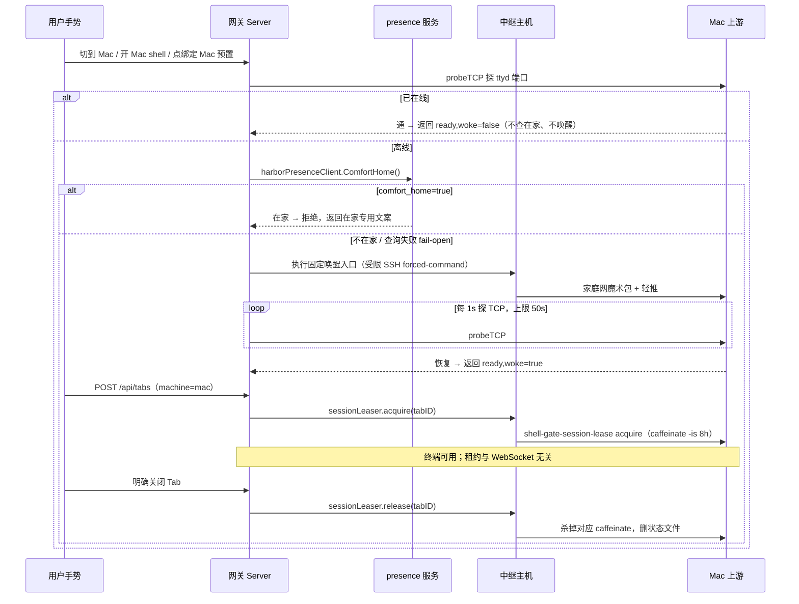

# Mac 上游唤醒与保活领域知识库

Current standalone requirements are authoritative in [architecture](ARCHITECTURE.md) and [deployment](DEPLOYMENT.md): local passkeys and SQLite are defaults; PostgreSQL, external authentication and wake/presence are optional. Earlier fleet-specific examples below are historical context. Server session, proxy, tab and preset handlers now reside in separate files.
> 产品北极星：shell-gate 是自托管浏览器终端门禁：Mac 上游平时照常睡眠，仅用户主动使用时按需唤醒并按 Tab 持有睡眠租约，在家时禁止一切网络唤醒。
> 主指南复用不重写：本库的安装步骤权威源是 `docs/MAC_UPSTREAM_GUIDE.md`；结论源是 `docs/design/2026-09-09-wake-suppress-when-home.md` 与 `docs/troubleshooting/2026-09-10-mac-corral-line-by-line-refresh.md`。本库只收敛"为什么这样做 + 代码落点 + 易错点"，不复制主指南的操作步骤全文。

## §0 范围与速览

| # | 项 | 说明 |
|---|---|---|
| 1 | 产品北极星 | Mac 平时照常睡眠；仅用户主动使用时唤醒并按 Tab 持租约，在家禁一切网络唤醒 |
| 2 | 适用机器 | 仅 `mac` 这台上游；linux 默认在线，不走唤醒/租约路径 |
| 3 | 唤醒触发三件套 | 切到 Mac / 开 Mac shell / 点绑定 Mac 的预置，经中继主机家庭网一次性唤醒并等 ttyd 恢复 |
| 4 | 在家信号 | presence 服务 `GET /v1/presence` 的 `comfort_home` 字段（示例映射到家庭自动化平台的在家开关）；失败 fail-open |
| 5 | 租约粒度 | 每个 Mac Tab 一个独立睡眠断言（`caffeinate -is`，8 小时自毁）；与 ttyd WebSocket 解耦 |
| 6 | 压缩版 ttyd | `shell-gate-ttyd`（ttyd 1.7.7 + lws 4.3.10 + permessage-deflate）；禁 Homebrew 版上线 |
| 7 | 监听与防火墙面 | ttyd 只绑隧道地址（如 ZeroTier）；pf 只放行已评审的网关出口到 7681；路由器不转发 22/7681 |
| 8 | 主指南 | `docs/MAC_UPSTREAM_GUIDE.md`（安装/LaunchAgent/pf/接入/排查顺序） |
| 9 | 非目标 | 通用多上游反代实现、workspace 渲染、双边缘选路、通行密钥流程（见 §8 相关域） |
| 10 | 状态查询入口 | `GET /api/machines`（`wakeable` 字段）、`POST /api/machines/{name}/ready`（`woke` 字段） |

## §1 产品语义

### 1.1 平时睡眠，按需唤醒

Mac 没有常驻在线义务。睡眠是默认态，唤醒是例外，且例外只许由明确的用户手势触发。
后台健康探测、隐藏 Tab 重连、定时任务一律不得调用唤醒——否则 Mac 会在用户不用它时被反复叫醒。
这条约束写死在 `internal/server/wake.go` 中 `upstreamWaker.ensureReady()` 的注释里，是代码级禁令，不是运维建议。

### 1.2 唤醒触发三件套

只有三类用户动作允许走到唤醒：

1. 用户把机器选择切到 Mac；
2. 用户开一个落点为 Mac 的 shell（`POST /api/tabs` 带 `machine=mac`，或默认机就是 Mac 时的「＋ shell」）；
3. 用户点击绑定了 Mac 的预置（预置 `machine` 列非空时以预置为准，见 `Server.handleCreateTab()`）。

三者在服务端汇合于同一函数：`Server.handleCreateTab()` 与 `Server.handleMachineReady()` 都先调 `upstream.ensureReady()`，
而 `upstream.ensureReady()` 只是 `upstreamWaker.ensureReady()` 的薄转发。前端点火位置不同，服务端闸门只有一个。

### 1.3 一次性唤醒 + 等 ttyd 恢复

唤醒不是"发个包就返回"，而是"发包 + 轮询等到 ttyd TCP 可达才算成功"。
`upstreamWaker.ensureReady()` 的流程：先 `probeTCP()` 探目标端口，通了直接返回 `(false, nil)`（没唤醒，不查在家）；
不通才进唤醒分支：先 `upstreamWaker.rejectIfAtHome()` 查闸门，再 `runWakeCommand()` 执行固定入口命令，
最后以 `wakeProbeInterval`（1s）为周期轮询 `probeTCP()`，直到 `wakeReadyTimeout`（50s）超时。
命令执行本身另有 `wakeCommandTimeout`（25s）上限。调用方按返回值区分三种结局：

- `(false, nil)`：本来就在线，什么都没做；
- `(true, nil)`：离线 → 唤醒 → 恢复，前端可继续建 Tab；
- `err`：唤醒失败或在家被拦，前端展示 `wakeFailureMessage()` 的文案（在家抑制有专用文案，不伪装成"未接电/关机"）。

### 1.4 租约语义（睡眠断言与 Tab 同生共死，但与连接无关）

`Server.handleCreateTab()` 在 Tab 落库成功后调 `sessionLeaser.acquire()`；
`Server.handleDeleteTab()` 在 Tab 删除成功后调 `sessionLeaser.release()`（失败只记日志，不把 Tab 留回工作台，远端靠硬超时兜底）；
门禁重启后 `Server.reacquireSessionLeases()` 为库里仍在的 Mac Tab 补申请。
租约与 ttyd WebSocket 完全解耦——浏览器切后台、锁屏、网络暂断、被系统暂停、刷新页面都不释放；
只有"用户在工作台内明确关闭 Tab"才释放，浏览器异常退出发不出关闭通知时靠 Mac 侧 8 小时自毁。

### 1.5 端到端序列



## §2 服务端链路与关键路径

唤醒与租约在门禁侧是两个正交部件，挂在同一 `upstream` 结构上（`internal/server/server.go` 中 `Server.initUpstreams()` 组装）：

- 唤醒：`upstream.waker`（`*upstreamWaker`），有 `WakeCommand` 才非空；`GET /api/machines` 的 `wakeable` 字段即"waker 是否非空"。
- 租约：`upstream.leaser`（`*sessionLeaser`），有 `SessionLeaseCommand` 才非空；linux 不配，`leaser` 为空即跳过。
- 在家闸门：`harborPresenceClient` 只建一个实例，仅当 `Config.suppressWakeWhenHome()` 为真（URL 已配且机器在 `SHELL_WAKE_HOME_PRESENCE_MACHINES` 名单内）才注入该机器的 waker。

并发语义：`upstreamWaker` 内有 `sync.Mutex`（单测未注入 locker 时的进程内串行化）；
生产走 `Store.WithWakeLock()`——Postgres 用 advisory lock（`wakeLockKey()` 按机器名哈希），SQLite/单测走进程内 `wakeMu`。
于是双网关实例同时点 Mac 时只发一次魔术包，对应单测 `TestUpstreamWakerCoalescesConcurrentRequests`。
租约侧无锁：`sessionLeaser.acquire()` / `release()` 按 Tab ID 幂等操作 Mac 侧状态文件，天然可并发。

### 2.5 路径清单（实现别名对照）

- `internal/server/wake.go` —— `upstreamWaker.ensureReady()` / `upstreamWaker.rejectIfAtHome()` / `runWakeCommand()` / `probeTCP()` / `wakeFailureMessage()` / `ErrWakeSuppressedAtHome`
- `internal/server/lease.go` —— `sessionLeaser.acquire()` / `sessionLeaser.release()` / `sessionLeaser.runWithTimeout()` / `runSessionLeaseCommand()` / `validSessionLeaseID()`
- `internal/server/presence.go` —— `harborPresenceClient.ComfortHome()` / `newHarborPresenceClient()`（禁代理、禁跟随重定向、3s 超时）
- `internal/server/config.go` —— `parseWakeHomePresence()` / `Config.suppressWakeWhenHome()` / `attachWakeCommands()` / `attachSessionLeaseCommands()` / `validateWakeCommands()` / `validateSessionLeaseCommands()`
- `internal/server/tab_handlers.go` —— `Server.handleCreateTab()`（先唤醒再落库再持租约，租约失败回滚 Tab） / `Server.handleDeleteTab()`（先删库再释放，释放失败不回滚）
- `internal/server/server.go` —— `Server.initUpstreams()` / `Server.reacquireSessionLeases()` / `Server.handleMachineReady()` / `upstream.ensureReady()` / `Server.handleMachines()`
- `internal/server/store/presets.go` —— `Store.WithWakeLock()`（多网关串行化唤醒）
- `deploy/relay/shell-gate-mac-bridge.sh` —— 中继侧受限桥（旧路径已迁移，以现路径为准）
- `deploy/edge/wake-mac-via-relay.sh` —— 网关侧唤醒固定入口
- `deploy/edge/lease-mac-via-relay.sh` —— 网关侧租约固定入口

## §3 上游安装与脚本职责

本节只给每个文件的"一句话职责 + 与本域的关系"，操作步骤以 `docs/MAC_UPSTREAM_GUIDE.md` 为准。

1. `deploy/mac/build-ttyd.sh` —— 自建压缩版 ttyd（ttyd 1.7.7 + lws 4.3.10，显式开 extensions/zlib、静态链 lws），构建后必跑 `check-ttyd-compression.py` 才可安装。
2. `deploy/mac/install-mac-upstream.sh` —— 一键安装/重装用户级上游（装 `terminal-shell` 与 keepalive、渲染 plist、跑构建、bootstrap LaunchAgent）；防火墙/SSH 变更刻意不在此脚本内。
3. `deploy/mac/ttyd-keepalive.sh` —— LaunchAgent 托管的保活入口：等隧道地址就绪、端口被占则待命不抢，优先选 `shell-gate-ttyd`，以 `-W -a -m 0 -P 30 -H X-Webauth-User -t rendererType=canvas` 起 ttyd。
4. `deploy/mac/shell-gate-session-lease` —— 按 Tab 持防睡眠断言的唯一执行者：`acquire <32位hex>` 起 `caffeinate -is -t 28800` 并记 pid+启动时间，`release` 按指纹杀，异常退出靠 8 小时自毁。
5. `deploy/mac/terminal-shell`（现用登录脚本；已接替被删除的旧登录脚本） —— ttyd 每连接的登录壳：补齐账号默认 `SHELL`（缺则读 dscl）与 `COLORTERM=truecolor`，无参开登录壳，有参走 `bash -lc` 并兼容旧门禁写死的 `exec bash -lic`。
6. `deploy/mac/enable-remote-and-pf.sh` —— 管理员一次性动作：校验已评审的 pf 配置并安装锚点（`pmset womp`、拉起 sshd 在新系统上改走系统设置手动开）。
7. `deploy/mac/harden-upstream-security.sh` —— 管理员显式加固：禁 SSH 密码与 keyboard-interactive、禁 root、跑前必须先验证过密钥登录（`--key-access-verified`）。
8. `deploy/mac/pf-ttyd-restrict.conf` —— pf 锚点规则模板：只放行网关出口到本机 7681，其余 DROP；SSH 策略刻意不在此模板内。
9. `deploy/mac/io.shellgate.ttyd.plist` —— LaunchAgent 定义：`KeepAlive` + `RunAtLoad`，且 `ProcessType=Interactive`（2026-09-29 实测结论，否则整棵 ttyd 树被 launchd 降速，见 §6）。
10. `deploy/mac/check-ttyd-compression.py` —— 构建门禁：在 loopback 起候选 ttyd，要求 101 握手带回 `permessage-deflate`，并做 8 KiB / 1 MiB 压缩粘贴双向字节一致往返。
11. `deploy/relay/shell-gate-mac-bridge.sh` —— 中继侧受限 SSH 桥（forced-command）：空命令只跑唤醒脚本；`lease acquire|release <32位hex>` 经隧道转发给 Mac 租约脚本，其它一律拒绝，绝不解释成通用 shell。
12. `deploy/edge/wake-mac-via-relay.sh` —— 各网关实例的 `SHELL_WAKE_COMMANDS` 固定入口：用专用钥匙连中继别名发空命令（唤醒），无参数。
13. `deploy/edge/lease-mac-via-relay.sh` —— 网关的 `SHELL_SESSION_LEASE_COMMANDS` 固定入口：`acquire|release TAB_ID`，动作与 Tab ID 独立传参（门禁侧 `sessionLeaser.runWithTimeout()` 亦做 32 位小写 hex 校验，双层格式闸）。
14. `deploy/ttyd-keepalive.sh` —— 中继侧用户级 ttyd 兜底（root 单元 `Restart=on-failure` 遇干净 SIGTERM 不重启的双保险，见 §6）；端口被占就地等待不抢，与 root 单元共存。

新接一台上游机器四件套 checklist（照抄 Mac 模式）：ttyd 以 `-H X-Webauth-User` + `-a` 启动并经登录脚本拉 shell；
systemd/LaunchAgent 托管 + keepalive 兜底；账号登录壳按本机习惯加载提示符与行编辑插件（禁为网页链路单独裁剪）；
网关到它网络可达且防火墙只放行网关出口（教训：曾只放行单网关，见根 AGENTS.md 多上游小节）。

## §4 数据与状态

本域无专属表；租约状态为运行时态+Mac 侧防睡断言

说明：门禁侧不为租约建表。唯一持久的是 Tab 目录本身（账号级 Tab 记忆，属于"Tab 服务端记忆"域，不在本库收敛范围）；
`Server.reacquireSessionLeases()` 在重启后以"库里仍在的 Mac Tab"为准补申请租约，租约失败只记日志、不删 Tab。
Mac 侧状态是 `shell-gate-session-lease` 的状态目录（默认 `~/.config/shell-gate/leases/<32位tab-id>`，内记 caffeinate pid 与启动时间，
目录权限 700，release 时删除；异常退出无 release 时靠 `caffeinate -t 28800` 的 8 小时上限自毁）。
进程合法性靠"pid + `lstart` + 命令行指纹"三重比对（`managed_pid()` / `legacy_pid()`），防止 pid 复用误杀。

## §5 部署与作业索引

| 脚本 / 单元 | 跑在哪台 | 何时用 | 说明 |
|---|---|---|---|
| `deploy/mac/build-ttyd.sh` | Mac 本机 | 首次安装、升级 ttyd/lws、压缩协商失效回归时 | 产物进 `~/.local/share/shell-gate/ttyd-1.7.7-lws-4.3.10-deflate/bin/ttyd` 并软链 `~/.local/bin/shell-gate-ttyd`；跑完必须重启上游且旧 Tab 需重开 |
| `deploy/mac/install-mac-upstream.sh` | Mac 本机（用户态，无需 sudo） | 一键安装/重装 | 含渲染 plist 与 bootstrap LaunchAgent；`--no-start` 只渲染不启动 |
| `deploy/mac/io.shellgate.ttyd.plist` | Mac 本机 `~/Library/LaunchAgents/` | 安装时渲染、改地址/路径后重渲染 | `KeepAlive` 保证干净退出也拉起；`ProcessType=Interactive` 防降速；改完 `launchctl kickstart -k` |
| `deploy/mac/ttyd-keepalive.sh` | Mac 本机（被 LaunchAgent 拉起） | 常驻 | 等隧道地址就绪后起 ttyd；端口被占待命不抢；`-m 0 -P 30` 抗外网拥堵秒断 |
| `deploy/mac/terminal-shell` | Mac 本机 `~/.local/bin/` | 常驻（ttyd 每连接执行） | 补 `SHELL` + `COLORTERM=truecolor`；防睡眠禁止绑在此（见 §6） |
| `deploy/mac/shell-gate-session-lease` | Mac 本机（经中继桥远程调用） | 建/关 Mac Tab 时由门禁触发 | 唯一防睡执行者；禁给 ttyd 或登录用户装永久 `caffeinate` |
| `deploy/mac/check-ttyd-compression.py` | 构建机（Mac 本机或验证机） | 换 ttyd/lws 后、"一行行刷"回归时 | 用法 `python3 check-ttyd-compression.py /path/to/ttyd`；含 ≥8 KiB 与 1 MiB 往返 |
| `deploy/mac/enable-remote-and-pf.sh` | Mac 本机（需 sudo + 已评审配置） | 首次接入、改放行节点（如新增网关实例）后 | 安装 pf 锚点；新系统 `systemsetup -setremotelogin` 报 Full Disk Access 时改走系统设置手动开远程登录 |
| `deploy/mac/harden-upstream-security.sh` | Mac 本机（需 sudo） | 安装完成后、验证过密钥登录后 | 禁密码/keyboard-interactive；审计示例见 `docs/troubleshooting/2026-09-05-dual-upstream-security-audit.md` |
| `deploy/relay/shell-gate-mac-bridge.sh` | 中继主机（`authorized_keys` forced-command） | 常驻（门禁每次唤醒/租约都经此） | 钥匙只许唤醒或单个合法租约；端口转发/PTY 不得放行 |
| `deploy/edge/wake-mac-via-relay.sh` | 网关（各边缘实例，`SHELL_WAKE_COMMANDS`） | 点 Mac 且离线时 | 启动时校验存在且可执行（`validateWakeCommands()`），缺文件直接启动失败 |
| `deploy/edge/lease-mac-via-relay.sh` | 网关（各边缘实例，`SHELL_SESSION_LEASE_COMMANDS`） | 建/关 Mac Tab、门禁重启补租约时 | 同上由 `validateSessionLeaseCommands()` 启动校验；Tab ID 非法在门禁侧即拦，不出网 |
| `deploy/ttyd-keepalive.sh` | 中继主机（用户级 systemd） | 常驻兜底 | root 单元正常时待命；root 单元死后顶上；绝不抢端口 |

网关侧配置示例（各边缘实例各一份，令牌只放私有 `.env`，勿入库）：

```bash
SHELL_TTYD_TARGETS=linux=http://terminal.example.com:7681,mac=http://198.51.100.7:7681
# 注：198.51.100.7 为文档示例地址（TEST-NET-2），部署时替换为 Mac 的隧道地址。
SHELL_WAKE_COMMANDS=mac=/opt/shell-gate/wake-mac-via-relay.sh
SHELL_SESSION_LEASE_COMMANDS=mac=/opt/shell-gate/lease-mac-via-relay.sh
SHELL_WAKE_HOME_PRESENCE_URL=http://terminal.example.com:18780/v1/presence
SHELL_WAKE_HOME_PRESENCE_TOKEN=...
SHELL_WAKE_HOME_PRESENCE_MACHINES=mac
```

另注意中继侧 SSH 约束示例：用独立 Host 别名分别走隧道与家庭网，并禁用代理转发以免握手失败；
租约走隧道、唤醒走家庭网（租约发生在探通之后，用同一条已证可达的路）。

## §6 坑与裁定

1. **在家抑制只认 presence 的 `comfort_home`**：以"人在家附近"的围栏意图为准，不用仅反映"设备连着家里局域网"的信号；
否则人在外但手机连着家里 Wi-Fi 会被永久抑制。代码落点：`harborPresenceClient.ComfortHome()` 只解析 `comfort_home` 字段
（回包里即使另有表示局域网在线的字段也不影响结果，见 `TestHarborPresenceClientComfortHome`）。
2. ****AI pitfall** —— presence 查询失败必须 fail-open，禁 fail-closed**：`upstreamWaker.rejectIfAtHome()` 在
`ComfortHome()` 报错时打日志后放行（人在外 + presence 服务挂掉时仍叫得醒 Mac）。
若写成"查不到就当在家拒绝"，一次 presence 服务发版、一次中继到 presence 服务的网络缺失，就会把人在外的唯一唤醒路锁死，
且症状（"点 Mac 没反应"）与睡眠不可达一模一样，极难排查。单测 `TestUpstreamWakerFailOpenOnPresenceError` 守这条；
生产未刻意掐链路验证（见设计文档验收第 4 项）。
3. ****AI pitfall** —— 租约必须防"系统睡眠"，只防"空闲睡眠"等于没防**：旧版 `shell-gate-session-lease` 只用
`caffeinate -i`，Mac 仍进 Maintenance Sleep，网关到 Mac 的隧道断联（时间线摘录：
进 Maintenance Sleep → 网关侧报 `no route to host` → DarkWake 后自愈，全程 ttyd 正常）。
现版用 `caffeinate -is -t 28800`，旧 `-i` 断言由 `legacy_pid()` 识别并就地替换/释放。
排查"Mac 睡眠窗口连不上"先查电源日志与隧道状态，不要重装 ttyd。
4. **后台探测、隐藏 Tab 重连、定时任务调用唤醒 = 半夜叫醒 Mac**：`upstreamWaker.ensureReady()` 只允许出现在
`Server.handleCreateTab()` 与 `Server.handleMachineReady()` 两个用户动作路径。
健康探测走 `netMonitor` 被动采样，开 Tab 失败走 60s/5 次重连护栏（那是另一域），两者都不许顺手调唤醒。
Code review 见到第三处 `ensureReady()` 调用即应打回。（High confidence：wake.go 注释原文即此禁令。）
5. ****AI pitfall** —— 禁给整个 ttyd 或登录用户装永久常驻 `caffeinate`、禁关系统睡眠**：租约是按 Tab 生死的临时断言，
常驻断言等于 Mac 永不睡眠，违背产品北极星，且掩盖"唤醒链路其实已坏"（Mac 永远在线，唤醒失败永远暴露不出来）。
`terminal-shell` 头注释明示"是否防睡眠由门禁按 Tab 单独管理，不能绑定到 WebSocket"——同理更不能绑到用户态常驻。
6. ****AI pitfall** —— 禁把 Homebrew ttyd 当默认上线**：brew 的 lws 5.0 默认 `LWS_WITHOUT_EXTENSIONS`，
`/ws` 握手不回 `permessage-deflate`，外网经网关跑全屏 TUI 刷新一路明文拥塞，表现"一行行刷"而中继侧同入口正常
（对照：同等 4 KiB 刷新从 ~15s/收不全回到 ~2s/120 帧）。
`ttyd-keepalive.sh` 的候选顺序把 `shell-gate-ttyd` 放最前就是为此；验收以"从网关提议压缩必须协商成功"为准，
不要以"本机看着能跑"为准。（High confidence：ttyd-keepalive.sh 注释 + 排查记录对照表。）
7. **禁给 lws 5.0 开 extensions 就上线**：该组合复现 `ttyd #1532`（大段压缩粘贴 `rx buffer underflow` 断线），
已在临时实例复现、未部署。修法只有一条：`deploy/mac/build-ttyd.sh` 的"ttyd 1.7.7 + lws 4.3.10 + 静态链"组合，
且改完必跑 `check-ttyd-compression.py`（含 1 MiB 往返）。降刷新/拼帧/换有线一律否决（2026-09-10 用户裁定，见排查记录硬约束）。
8. **LaunchAgent 必须 `ProcessType=Interactive`**（Low confidence：结论来自指南 2026-09-29 实测记录，未在本机复测）：
缺此项 launchd 对整棵 ttyd 树施默认 clamp（Web Tab shell PRI 20 vs iTerm 31，忙循环 14% vs 48–64% CPU），
且 Tab 派生的常驻物（如 TUI 保活进程）会继承。检查：`ps -o pri= -p <web-tab shell pid>` 应为 31。
代价是改 plist 会重启 ttyd、关闭已开 Web Tab（重连成新 shell），宜选低峰操作。
9. **登录脚本必须补 `SHELL` 与 `COLORTERM=truecolor`**：LaunchAgent/ttyd 常不带这两项，缺了门禁的
`exec "$SHELL" -lic` 掉进错壳、TUI 被压成 256 色（发脏），症状与上游 SSH 缺 `COLORTERM` 时相同。
落点在 `terminal-shell` 的 `resolve_login_shell()`（缺则读 dscl，再缺回落 `/bin/zsh`）；改完重装脚本 + 新连接生效，旧 Tab 需重开。
10. **上游 root 单元干净退出不自愈，需用户级双保险**：某次 `ttyd-shellgate.service`（`Restart=on-failure`）
收到 SIGTERM 以退出码 0 退出，systemd 视为正常停止不再拉起，静默停机 5 小时。
`deploy/ttyd-keepalive.sh` + 用户级 `Restart=always` 兜底，启动前探端口、被占就地等待不抢，可与 root 单元共存。
根治仍需 root 把单元改成 `Restart=always`；改完本兜底降级为双保险，不要删。
附带假象：`ps` 见 `ttyd` 显示 `-t rendererType canvas` 两段是 1.7.7 `strsep` 改写 argv 所致，"进程在监听"本身即参数正确证据。
11. **`-t rendererType=canvas` 必须是一个参数**：手敲拆成 `-t rendererType canvas` 会 `invalid client option` 直接退出
（systemd 那份能跑是传参方式不同）。Mac 侧与中继侧 keepalive 脚本注释均有此条；改启动参数后必须真连验 101 握手。
12. **秒断看保活参数，不要先怪网络**：`ttyd.err.log` 反复 `VALIDITY TIMEOUT ... (ping=5, hangup=10)` 即网关到 Mac 的 WS
保活没通过，Mac 侧已用 `-m 0 -P 30` 缓解（拥堵突发时 10s hangup 扛不住）。但拉长保活不能代替压缩；
回归时先核压缩协商是否还在、是否退回 brew 二进制、是否丢了 `-P 30`。（High confidence：排查记录并行症状小节。）

## §7 可执行验证

1. 门禁侧唤醒/租约/presence 单测（真实测试名，禁止改名后不更新本条）：
```bash
go test -race ./internal/server/ -run 'TestUpstreamWaker(EnsureReady|TimesOutWaitingForReady|CoalescesConcurrentRequests|SuppressesWhenAtHome|WakesWhenAway|FailOpenOnPresenceError|SkipsHomeCheckWhenAlreadyOnline)$' -v
go test -race ./internal/server/ -run 'TestSessionLeaser(PassesFixedActionAndTabID|RejectsInvalidTabIDWithoutExecuting)$|TestValidSessionLeaseID' -v
go test -race ./internal/server/ -run 'TestHarborPresenceClient(ComfortHome|RejectsRedirect)$|TestParseWakeHomePresence|TestWakeFailureMessage' -v
```
2. 压缩版构建门禁（换 ttyd/lws 后必跑；含 8 KiB / 1 MiB 压缩粘贴双向字节一致）：
```bash
python3 deploy/mac/check-ttyd-compression.py ~/.local/bin/shell-gate-ttyd
# 期望：三个 PASS（8192/1048576 压缩输入 + 65536 明文输入），exact round trip
```
3. 监听面与 pf 放行检查（Mac 本机 + 网关对照）：
```bash
# Mac 本机：只应监听隧道地址，进程应为 shell-gate-ttyd 且日志含 libwebsockets 4.3.10
ps aux | grep -E 'shell-gate-ttyd|ttyd' | grep -v grep
/usr/sbin/lsof -nP -iTCP:7681 -sTCP:LISTEN
curl -H 'X-Webauth-User: operator@example.com' http://127.0.0.1:7681/ -o /dev/null -w '%{http_code}\n'  # 期望 200
# 网关侧（各边缘实例）：/ws 提议压缩必须协商成功
curl -s -D - -o /dev/null -H 'X-Webauth-User: operator@example.com' \
  -H 'Upgrade: websocket' -H 'Connection: Upgrade' \
  -H "Sec-WebSocket-Key: $(openssl rand -base64 16)" -H 'Sec-WebSocket-Version: 13' \
  -H 'Sec-WebSocket-Extensions: permessage-deflate' \
  http://198.51.100.7:7681/ws | grep -iE 'HTTP/|Sec-WebSocket-Extensions'
# 注：198.51.100.7 为文档示例地址，替换为 Mac 的隧道地址后执行。
# 期望：101 且带回 Sec-WebSocket-Extensions: permessage-deflate
```
4. 在家抑制真连验收（停 ttyd 模拟离线，不整机睡眠；`comfort_home` 在 presence 服务侧翻转）：
```bash
# comfort_home=off + Mac 不可达 → 仍唤醒：POST /api/machines/mac/ready 期望 {"ready":true,"woke":true}
# comfort_home=on + Mac 不可达 → 0.4s 内 503，文案含"在家"（且中继侧确认未发魔术包）
# comfort_home=on + Mac 已醒 → {"ready":true,"woke":false}（已在线不查在家）
```
5. 租约断言抽查（Mac 本机，建一个 Mac Tab 后）：
```bash
ls ~/.config/shell-gate/leases/            # 应有 <32位tab-id> 文件
ps aux | grep 'caffeinate -is' | grep -v grep  # 应与状态文件 pid 一致；关闭 Tab 后消失
ps -o pri= -p <web-tab shell pid>            # 期望 31（Interactive 生效）
```

## §8 相关域与边界（非目标）

- 终端反代：唤醒恢复的是"ttyd 可达"，转发本身（`newTTYDProxy`、握手采样、` countingConn` 字节统计）属反代域；本库只要求"唤醒后必须从门禁验 HTTP 200 与 WS 101"。
- 工作台前端：`workspace.html` 的机器 pill、按机 Tab 集合、顶栏手势是唤醒的点火源，但渲染细节属前端域。
- 双边缘部署 backlog：各网关实例到 Mac 的可达差异（白名单、选路）属部署域；家里的 `SHELL_WAKE_HOME_PRESENCE_*` 需各实例配一份。
- 网络监控：`netmon` 的三段测量是"ttyd 是否恢复"的判定口径来源，但监控面板本身属可观测域。
- 通行密钥与会话：`SHELL_SESSION_TTL`、Cookie、`/api/tabs` 鉴权属认证域；本库只依赖"已登录态才能调唤醒/建 Tab"。
- Tab 服务端记忆：跨刷新/跨浏览器恢复、"有记忆禁暗开"属 Tab 域；本库只规定"重启后补租约失败不删 Tab"。

## §9 缺口与待补

- Missing user experience input：本库编写期间未做用户问答；以下为写作方已知的待确认项，需后续补采纳后更新本文：
  - M1 + Wi-Fi 合盖深睡偶发叫不醒的当前发生率（指南称"叫不醒就停"，无最新统计）。
  - 在家抑制生产验收第 4 项（presence 服务不可达 fail-open）仍只有单测覆盖，未做生产掐链路演练。
  - `shell-gate-wake-mac`（中继侧 `~/.local/bin`）的魔术包目标 MAC 与重试策略不在仓内，无版本化记录；双重保险（脚本侧再读本地 presence）未实施。
  - Mac 离家场景（家庭网不可达、ZeroTier 在线）下唤醒必然失败时的前端文案是否需区分"离家睡着叫不醒"与"在家已抑制"，未定。

## 附录A 领域语言对照

| 业务概念 | 正文用词 | 实现别名 |
|---|---|---|
| 按需唤醒 | 唤醒 | wake, 魔术包/中继唤醒 |
| 在家抑制 | 在家抑制 | wake-suppress, comfort_home |
| 睡眠租约 | 租约 | session lease, shell-gate-session-lease |
| 自建压缩 ttyd | 压缩版 ttyd | shell-gate-ttyd |
| 上游安装 | 上游安装 | deploy/mac |

## 附录B 配置速查

| 环境变量 | 作用 | 配错后果 |
|---|---|---|
| `SHELL_TTYD_TARGETS` | 上游列表，第一台为默认 | 机器名拼错/重复/非法直接启动失败（fail-fast，故意） |
| `SHELL_WAKE_COMMANDS` | `机器=绝对可执行路径` | 缺文件/不可执行启动失败（`validateWakeCommands()`）；引用未配置机器启动失败 |
| `SHELL_SESSION_LEASE_COMMANDS` | `机器=绝对可执行路径` | 同上（`validateSessionLeaseCommands()`）；linux 不配即无租约 |
| `SHELL_WAKE_HOME_PRESENCE_URL` / `TOKEN` / `MACHINES` | 在家抑制三件套 | 只配一半启动失败；引用未知机器启动失败；全空=功能关闭（与改造前行为一致） |
| `SHELL_GATE_RELAY` | 门禁侧 relay 别名 | 唤醒/租约入口找不到，点 Mac 直接 503 |
| `SHELL_GATE_MAC_HOST` / `SHELL_GATE_MAC_LEASE_PATH` | 中继桥转发目标 | 租约下发失败，建 Mac Tab 报"未能保持终端会话" |

## 附录C 超时与常量

| 常量 | 值 | 位置 |
|---|---|---|
| `wakeCommandTimeout` | 25s | `internal/server/wake.go`（`upstreamWaker` 唤醒命令执行上限） |
| `wakeReadyTimeout` | 50s | 同上（发包后等 ttyd 恢复上限） |
| `wakeProbeTimeout` / `wakeProbeInterval` | 1s / 1s | 同上（TCP 探测超时/轮询间隔） |
| `sessionLeaseCommandTimeout` | 12s | `internal/server/lease.go`（单次 acquire/release 上限） |
| `presenceCheckTimeout` | 3s | `internal/server/presence.go`（presence 查询 HTTP 超时；失败即 fail-open） |
| `lease_seconds` | 28800（8h） | `deploy/mac/shell-gate-session-lease`（异常退出自毁上限） |
| `-m 0 -P 30` | 无客户端上限/保活拉长 | `deploy/mac/ttyd-keepalive.sh`（抗外网拥堵秒断；hangup≈37s） |
