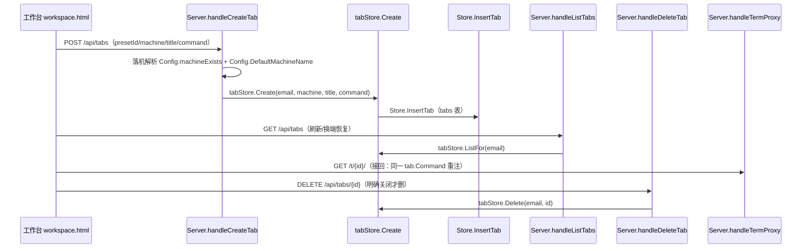

# Tab 服务端记忆知识库（Tab Persistence Knowledge Base）

Current standalone requirements are authoritative in [architecture](ARCHITECTURE.md) and [deployment](DEPLOYMENT.md): local passkeys and SQLite are defaults; PostgreSQL, external authentication and wake/presence are optional. Earlier fleet-specific examples below are historical context. Server session, proxy, tab and preset handlers now reside in separate files.
> 领域：浏览器终端页签（Tab）按账号的服务端目录记忆全链路——创建落机、启动命令注入接回、激活记忆、刷新/换端恢复、关闭删除语义、共享存储分工。
> 结论来源：`docs/design/2026-09-07-tab-server-persistence.md` 与 `docs/design/2026-08-24-multi-upstream.md` 的已裁定结论直接复用；本文件只沉淀实现口径、调用链与坑位，不重写设计论证。

## §0 Contents

| 行 | 节 | 内容 |
|---|---|---|
| 1 | §1 领域快照 | 北极星、边界、核心不变量 |
| 2 | §1.5 主流程图 | Tab 创建→记忆→恢复→关闭序列（mermaid，真实函数名） |
| 3 | §2 核心模型与决策链 | Tab 目录、落机优先级、激活恢复顺序 |
| 4 | §2.5 物理路径表 | 完整相对路径与职责 |
| 5 | §3 场景入口 | 创建 / 恢复 / 切换机器 / 关闭四条调用链 |
| 6 | §4 存储语义 | 真实表名列名、类型、业务含义、变更注意 |
| 7 | §5 接回语义 | 重注同一启动命令、不特判任何预置 |
| 8 | §6 约束与坑位 | ≥5 条，含 AI pitfall |
| 9 | §7 可执行验证 | 真实测试名 + 数据确认语句 |
| 10 | §8/§9 相邻域与待确认 | 相关域路由、误判排除、缺失输入声明 |

## §1 领域快照

shell-gate 的工作台 Tab 不是浏览器窗口的临时状态，而是一份**按账号记忆在服务端的 Tab 目录**：同一个白名单邮箱无论刷新页面、换浏览器还是换设备登录，看到的都是同一组未关闭的 Tab；只有在工作台内明确关闭某个 Tab，服务端才删除它的目录记录。

本域覆盖：创建时的落机解析（预置绑定 > 请求指定 > 默认机器）、绑定他机预置点开时顺带切换机器选择、切换机器即切换该机 Tab 集合（他机后台保活）、激活恢复顺序（该机上次激活 > 该机最近 Tab > 空态）、刷新/换端按账号全量恢复、关闭删除语义、备用门禁共享库与本地库的分工、`presets.machine` 列迁移与 `preset_defaults_applied` 记账中与 Tab 创建相关的部分。

本域不覆盖：预置的增删改管理面板细节、反代 Transport 实现细节、工作台视觉渲染细节、Mac 睡眠租约实现细节、双边缘时延选路细节——这些分属相邻域（见 §8）。

核心不变量（改任何代码都不得破坏）：

1. Tab 目录以服务端共享存储为唯一真相；浏览器只记展示偏好（当前选中、每台机器上次激活）。
2. 有记忆时禁止暗中新建空 Tab；账号下零 Tab 的首次进入才自动开一个空 shell。
3. 接回是通用的：再连时重注同一条启动命令，不为任何预置写特判。
4. 用户删除默认预置后禁止再按命令名补种（`preset_defaults_applied` 记账保证只种一次）。
5. 单机部署界面零变化：只有一台机器时机器选择器与按机过滤全部不渲染。

## §1.5 主流程图



按机切换流程（`workspace.html` 内函数均为真实名）：

```mermaid
flowchart TD
    A[selectMachine(name)] --> B[rememberActiveForMachine 记录离开前激活态]
    B --> C{当前激活 Tab 是否在新机器上?}
    C -- 是 --> D[保持该 Tab]
    C -- 否 --> E[rememberedTabOnMachine 该机上次激活]
    E -- 命中且仍存在 --> F[恢复该 Tab]
    E -- 未命中或已关闭 --> G[lastTabOnMachine 该机最近 Tab]
    G -- 有 --> H[落到该机最近 Tab]
    G -- 无 --> I[空态提示在该机新建]
```

## §2 核心模型与决策链

### Tab 目录（per-account tab directory）

服务端按邮箱持久保存的 Tab 集合。内存对象是 `TabSession`（`TabSession` 首次出现后简称 Tab 会话），持久行是 `store.Tab`（`store.Tab` 首次出现后简称 Tab 行）。两者字段一一对应：归属邮箱、目标机器、标题、启动命令、创建时间。Tab 会话的身份是随机 ID（`newSessionID()` 生成 32 位十六进制），浏览器用 `/t/{id}/`（`handleTermProxy` 首次出现后简称终端反代入口）访问它。

创建→记忆→恢复→关闭主流程：

1. **创建**：工作台 `openTab()` 经 `POST /api/tabs` 建 Tab，服务端落机后写入 Tab 目录，返回 `id/title/command/machine/path`。
2. **记忆**：写入即持久，门禁进程重启不丢；浏览器侧只把当前选中与每机上次激活记进 `sessionStorage`（键 `TAB_STATE_KEY`）。
3. **恢复**：刷新或换端登录一律 `GET /api/tabs` 拉账号全量挂载；`restoreTabsAfterRefresh()` 为每个 Tab 建 iframe 面板（`mountTabPane()`），不做任何本窗口过滤。
4. **关闭**：工作台内点 × 调用 `DELETE /api/tabs/{id}`，服务端删目录记录；关网页、锁屏、切后台、异常退出都不删。

无显式状态机：Tab 只有"在目录里 / 不在目录里"两种存在性，没有进行中/已完成之类的中间状态。本节用主流程 + 下面的落机与激活两条决策链代替状态图。

### 落机（machine resolution）决策链

`Server.handleCreateTab()` 内的顺序是写死的（三优先级）：

1. 请求体缺省机器时，先填 `Config.DefaultMachineName()`（列表第一台；单机回退名为 `default`）。
2. 带 `presetId` 时读该账号的预置（`Store.Get()`），取其命令与标题；若预置绑定了机器（`presets.machine` 非空），直接覆盖第 1 步结果。
3. 用 `Config.machineExists()` 校验最终机器名，不存在返回 400。

即：**预置绑定 > 请求指定 > 默认机器**。创建/更新预置时同样校验绑定机器存在（`internal/server/presets.go` 的创建与更新handler），绑定未知机器的预置在入口就被 400 拦下，不会流入 Tab 创建。

绑定他机预置点开时顺带切机器：`openTab()` 收到服务端返回的 Tab 后，若其机器与当前选中不同，把选择器切到那台并重渲染机器 pill 与启动器（`renderMachines()` + `renderLaunchers()`），再激活新 Tab——保证新 Tab 立刻出现在当前 Tab 条上。

### 激活恢复顺序（按机）

切换机器 = 切换该机 Tab 集合（2026-09-05 裁定；2026-10-09 补记按机激活记忆）：Tab 条只渲染当前选中机器上的 Tab（`tabsOnMachine()`），其它机器的 Tab 与 iframe 留在 DOM 里保活，不关上游进程、不丢会话。

切机时的激活恢复顺序（以 `workspace.html` 的 `selectMachine()` 实现为准）：

1. 当前激活 Tab 若已在新机器上，保持不动。
2. 否则优先恢复该机上次激活的 Tab（激活记忆，`rememberedTabOnMachine()`；记忆放在本窗口 `sessionStorage` 按机器名记录，点选/新开/关闭后留下的当前 Tab 都会写入 `activeByMachine`）。
3. 记忆缺失或对应 Tab 已关闭，回落到该机最近一个 Tab（`lastTabOnMachine()`，即创建顺序最后一个）。
4. 该机一个 Tab 都没有，显示空态（多机时空态文案点名该机器，避免误以为全局为空）。

关闭当前 Tab 后留在同一台机器：取该机最近 Tab 接替，没有则空态，不擅自跳到别的机器（`closeTab()`）。

### 邮箱归一化

所有写入与查询统一经 `normalizeEmail()`（小写 + 去首尾空格）。大小写不同的同一邮箱看到的是同一套 Tab 目录，删除同样不区分大小写。禁止在 handler 层自己做大小写比较——统一走归一化后的值相等判断（`tabStore` 层 `Create` 即归一化，`store` 层 `InsertTab/ListTabs/CountTabs/DeleteTab` 入口即归一化）。

### Tab ID 与创建时间

ID 由 `newSessionID()` 生成（密码学随机 + sha256 截断 16 字节 hex，共 32 个十六进制字符），创建时一次生成、永不更改。`CreatedAt` 取创建时刻 UTC，同时决定 Tab 条顺序（`ListTabs` 按 `created_at ASC`）。前端本地数组顺序跟随服务端返回顺序追加；新开 Tab `push` 到末尾，与按创建时间排序一致。

### 服务端内存态说明

`tabStore`（`newTabStore` 首次出现后简称 Tab 存储）本身不持内存映射：`Create/Get/ListFor/Delete` 每次都直读共享库，双门禁进程看到的是同一套目录。这是"备用门禁/门禁节点双活共用 Postgres"成立的前提——任一门禁的创建与关闭对端立即可见。若未来有人给 `tabStore` 加进程内缓存，必须同步解决跨门禁失效，否则双活下两端目录分叉。

## §2.5 物理路径表

| 完整相对路径 | 职责 |
|---|---|
| `internal/server/tabs.go` | Tab 会话内存态与落库核心：`tabStore.Create/Get/ListFor/CountFor/Delete/All`，`TabSession` 定义 |
| `internal/server/tab_handlers.go` | Tab 的 HTTP 入口：`handleCreateTab/handleListTabs/handleDeleteTab/handleTermProxy`，落机优先级实现 |
| `internal/server/store/tabs.go` | Tab 持久化 SQL：`migrateTabs/InsertTab/GetTab/ListTabs/ListAllTabs/CountTabs/DeleteTab` |
| `internal/server/store/presets.go` | Tab 创建消费的上游字段来源：`Preset` 的 `command/machine`、`EnsureDefaults` 种一次记账、`presets.machine` 列迁移 |
| `internal/server/web/workspace.html` | Tab 目录的消费端：`openTab/restoreTabsAfterRefresh/closeTab/selectMachine/renderTabs/mountTabPane`，激活记忆与按机过滤 |
| `internal/server/config.go` | 落机基础：`Config.DefaultMachineName/Config.machineExists/parseMachines`，默认机器与 fail-fast 校验 |
| `internal/server/server.go` | 路由装配：`POST /api/tabs`、`GET /api/tabs`、`DELETE /api/tabs/{id}` 注册与上游初始化 |
| `deploy/database/init-shell-gate-db.sql` | 生产库建库脚本：`shell_gate` 库与 `shell_gate_app` 角色（表结构由 `migrate()` 兜底创建，见 §4） |

## §3 场景入口

### 场景一：新建 Tab（含预置）→ 落机 → 记忆

入口：工作台 `openTab()` → `POST /api/tabs`（`Server.handleCreateTab()`）→ `tabStore.Create()` → `Store.InsertTab()`。

调用链细节：前端先 `ensureMachineReady()`（可唤醒机器才走唤醒等待），请求体带 `presetId`（可选）、当前选中机器；服务端按 §2 落机链解析，`machineExists` 不过直接 400；落机后若该上游离线会尝试一次唤醒（`ensureReady`），失败返回 503；成功则 `tabStore.Create()` 生成随机 ID 并 `InsertTab` 落库；返回的 `path` 形如 `/t/{id}/`，前端 `mountTabPane()` 建 iframe 并 `activate()`。

标题回落：请求与预置都没给标题时，空命令取 `shell`，有命令取命令本身。

### 场景二：刷新 / 换浏览器登录 → 按账号全量恢复

入口：启动序列 `loadMachines().then(restoreTabsAfterRefresh)` → `GET /api/tabs`（`Server.handleListTabs()`）→ `tabStore.ListFor()` → `Store.ListTabs()`。

关键语义：`ListFor` 只按归属邮箱过滤、按创建时间升序返回，不做设备/窗口过滤；前端把返回的全部 Tab `mountTabPane()` 挂载；展示偏好（`savedTabState()` 读出的 `activeId/activeByMachine`）只决定选中哪个，不决定挂载哪些；账号下零 Tab 时才 `openTab({title:"shell"})` 自动开一个空 shell——有记忆时禁止走这条分支（守卫测试 `TestWorkspaceRefreshRestoresExistingTabsWithoutOpeningAnother` 逐字断言）。

### 场景三：切换机器 → 切换 Tab 集合 → 按机恢复激活

入口：机器 pill / ☰ 菜单 → `selectMachine()`（`workspace.html`）→ `tabsOnMachine/rememberedTabOnMachine/lastTabOnMachine` → `renderTabs()`。

服务端在此场景不参与：切换只是前端过滤（`renderTabs()` 只渲染 `tabsOnMachine(selectedMachine)`），他机 iframe 留在 DOM 保活；再次点击当前机器属于明确连接意图（允许唤醒），但机器没变时不重复切换集合。单机（`machines.length <= 1`）时 `tabsOnMachine()` 直接返回全量，机器选择器整体不渲染。

### 场景四：工作台内明确关闭 → 删除目录记录

入口：Tab × 按钮 → `closeTab()` → `DELETE /api/tabs/{id}`（`Server.handleDeleteTab()`）→ `tabStore.Delete()` → `Store.DeleteTab()`。

关键语义：先 `Get` 取 Tab 并核对归属邮箱（大小写不敏感，`EqualFold`），非本人返回 404；`DeleteTab` 按 `id AND email` 删除；成功后若该 Tab 有睡眠租约则释放（释放失败只记日志，不把 Tab 留回工作台，远端租约有 8 小时硬超时兜底）；前端同步清本地数组、移除 iframe、清理各机激活记忆中指向它的条目，并在同机内回落激活。

### 场景五：门禁重启 → 目录仍在 → 租约补申请

入口：进程启动 → 共享库 `migrate()` → `tabStore.All()`（`Store.ListAllTabs()`）。

Tab 目录随库重启而保留，不需要任何重建逻辑；工作台侧无感知，下次 `GET /api/tabs` 照常返回全量。Mac 睡眠租约是进程外状态，重启后按库里仍在的 Mac Tab 重新申请（`All` 存在的全部理由）；普通机器的 Tab 不需要任何补操作，反代是无状态的。守卫测试 `TestTabStoreSurvivesProcessReload` 覆盖"关库重开后同一 Tab 可读、按账号可列"。

### 场景六：绑定他机预置 → 落他机 → 选择器跟切

入口：预置按钮 → `openTab({presetId})` → 服务端按预置绑定落机 → 前端跟切 `selectedMachine`。

完整链：前端按"预置绑定优先于当前选择"算出 `targetMachine` 做唤醒预检，但请求体仍带当前选中机器（让服务端做最终裁决）；服务端返回的 Tab 若落在另一台机器，前端把选择器切到那台（`selectedMachine = tab.machine` + 持久化到 `localStorage` 的 `MACHINE_KEY`），重渲染机器 pill 与启动器，再激活新 Tab。若不跟切，新 Tab 会落在不可见的机器集合里——用户点了按钮却看不到新 Tab，这是 2026-08-24 设计 §6 明确点名的必现 bug 形态。

## §4 存储语义

生产真相源是备用门禁 `shared-postgres` 上的 `shell_gate` 库（`SHELL_DATABASE_URL` 指向它；门禁节点/备用门禁双门禁共用同一套 Tab 目录）。`deploy/database/init-shell-gate-db.sql` 只建库与授权（`CREATE DATABASE shell_gate`、`shell_gate_app` 角色、`CONNECT/USAGE/CREATE` 与默认权限授权），**表结构由应用启动时的 `migrate()` 兜底创建**（`Store.migrate/migrateTabs`），两处不要混淆：改表结构改 Go 迁移代码，不改建库 SQL。

本地 SQLite（`SHELL_DATABASE_URL` 给文件路径时 `store.Open()` 按路径走 `openSQLite`）仅用于单测与一次性导入（`ImportFromSQLite` 要求目标库为空才搬 `presets/tabs/preset_defaults_applied`），生产不以 `shell-gate.db` 为真相源。

### tabs 表（Tab 目录本体）

DDL 出处：`internal/server/store/tabs.go` 的 `migrateTabs()`；Postgres 与 SQLite 共用同一份建表语句（占位符由 `Store.q()` 转写 `?`→`$n`）。

| 列名 | 类型 | 业务含义 | 变更注意 |
|---|---|---|---|
| `id` | TEXT，主键 | Tab 会话随机 ID（`newSessionID()`，sha256 截断 16 字节 hex）；`/t/{id}/` 的地址锚点 | 由调用方生成后 `InsertTab`；全局唯一，不可复用、不可改 |
| `email` | TEXT，非空 | 归属账号；写入时 `normalizeEmail` 统一小写去空格，查询删除同样归一化 | 大小写不同仍是同一账号（测试显式覆盖）；删除必须带邮箱条件，禁止按 id 裸删 |
| `machine` | TEXT，非空 | 落机结果：Tab 开在哪台上游机器上；`handleTermProxy` 按它选反代上游 | `InsertTab` 要求非空；机器从部署配置移除后存量 Tab 走该机反代会 502，不做自动迁移 |
| `title` | TEXT，非空 | Tab 条显示名；预置名或回落名（`shell`/命令本身） | `InsertTab` 要求非空；只做展示，不参与路由 |
| `command` | TEXT，非空，默认 `''` | 启动命令原文（非包装后命令）；空表示登录 shell；接回时重注同一条 | 包装成 `interactiveLoginCommand` 的是反代层消费时做的事，库里永远存原文 |
| `created_at` | TEXT，非空 | 创建时间，`RFC3339Nano` 字符串；`ListTabs` 按它升序即 Tab 条顺序 | 文本存时间是既有约定；改格式必须同步改 `GetTab/ListTabs/ListAllTabs` 三处解析 |

索引：`idx_tabs_email_created ON tabs(email, created_at)`——按账号恢复的主查询路径；删改索引前先确认 `ListTabs/CountTabs` 口径。

### presets 表中与 Tab 创建相关的列（只写消费字段，管理细节属 backlog 域）

DDL 出处：`internal/server/store/presets.go` 的 `migrate()`；旧库无 `machine` 列时 `sqliteColumnExists("presets","machine")` 检测后幂等 `ALTER TABLE ... ADD COLUMN`。

| 列名 | 类型 | 业务含义（Tab 创建视角） | 变更注意 |
|---|---|---|---|
| `command` | TEXT，非空 | 预置的启动命令原文；`handleCreateTab` 带 `presetId` 时用它覆盖请求体命令 | 预置删改不影响已创建 Tab（Tab 存的是命令快照，不是引用） |
| `machine` | TEXT，非空，默认 `''` | 预置绑定的机器；空 = 跟随当前选择，非空 = 落机最高优先级 | 创建/更新时必须校验机器存在；`EnsureDefaults` 写入的默认预置不带绑定（跟随选择） |

### preset_defaults_applied 表（种一次记账，与 Tab 创建相关的部分）

| 列名 | 类型 | 业务含义 | 变更注意 |
|---|---|---|---|
| `email` | TEXT，主键 | 已种过默认预置的账号 | `EnsureDefaults` 用 `INSERT ... ON CONFLICT DO NOTHING` 保证每邮箱只种一次；老库已有预置但无记账的行由 `markExistingDefaults` 回填，避免升级后补种打扰删过默认项的用户 |
| `applied_at` | TEXT，非空 | 记账时间 | 只做审计，无业务分支依赖 |

与 Tab 创建的关联只有一条：用户删掉默认预置（如 corral）属于"已种过"，之后打开 Tab 列表不得再按命令名补种——否则管理面板点"删"像没反应。Tab 创建消费的是预置当前行，不感知记账表。

## §5 接回语义

接回（reattach，重注同一启动命令）是通用能力，不绑定任何预置：Tab 目录记住的是"哪台机器 + 哪条启动命令"，恢复时终端反代入口（`handleTermProxy`）按 Tab 归属找到它的机器上游，把存的 `tab.Command` 经请求上下文（`proxyCmdKey`）交给反代层，由 `interactiveLoginCommand()` 包成登录交互壳后作为 ttyd 的 `arg` 参数重新注入。程序若自带会话接回（如 Corral）则自然回到原会话；普通空 shell 或一次性命令落回的交互壳只保证"同一台机器、同一启动方式的新壳"，滚动历史与未退出的前台进程不保证还在。不做每 Tab 一条进程级中继或 tmux，那是另一项产品。

三条派生约束：接回不得为 Corral 或任何预置写特判；`arg` 里不得出现真实换行等控制字符（用 `$'…\n…'` 的 ANSI-C 引用由远端 shell 自己展开）；改命令包装后必须真连一次上游验 101 握手，不能只跑单测（这两条的根因见反代域，本域只声明约束归属）。

多设备同时打开同一 Tab：各自连上游、各起一条进程，不做抢唯一 PTY（第一期明确不做）。

### 接回时序（刷新后发生了什么）

1. `restoreTabsAfterRefresh()` 按账号全量 `GET /api/tabs`，为每个 Tab `mountTabPane()` 建 iframe。
2. 每个 iframe 载入 `/t/{id}/?rendererType=canvas&disableReconnect=true&theme=…`，终端反代入口按 `tab.Machine` 找到上游，把 `tab.Command` 包装后以 `arg` 注入 ttyd。
3. ttyd fork 新 shell 执行包装命令；自带接回的程序按自身逻辑回到原会话，其它 shell 从新登录态开始。
4. 断线恢复统一走 `enhance.js` 的连接保持层（`disableReconnect=true` 关掉 ttyd 自带重连避免两套打架；60 秒 5 次护栏防秒退命令无限刷屏）——恢复层属反代域，本域只保证"重连后仍是同一 Tab 的同一命令"。

## §6 约束与坑位

1. **禁把本窗口临时状态当唯一真相（AI pitfall）**：恢复必须用 `GET /api/tabs` 的账号全量；任何按"本窗口开过 / `sessionStorage` 里有"过滤服务端的写法都是倒退。`sessionStorage`（`TAB_STATE_KEY`）只存展示偏好（当前选中、每机上次激活），且回填时必须逐项校验对应 Tab 仍在账号目录里（`restoreTabsAfterRefresh` 对 `activeByMachine` 的过滤循环），过期记忆要删掉不能留着。
2. **有记忆禁止暗开空 shell（AI pitfall）**：启动序列只有 `tabs.length === 0` 才 `openTab({title:"shell"})`；凡是在恢复前、恢复失败重试里、或"没找到上次选中"时顺手 `openTab` 的写法都会导致刷新多出空 Tab。恢复失败（`GET /api/tabs` 503）时展示错误，不建 Tab。
3. **接回禁止特判任何预置**：`handleTermProxy` 与 `interactiveLoginCommand` 不得出现按命令名/标题名的分支；新增 TUI 类预置需要接回能力时，去改该程序自己，不动门禁。
4. **删默认预置后禁止补种**：`EnsureDefaults` 的 `ON CONFLICT DO NOTHING` 与 `markExistingDefaults` 回填是删后不补种的全部保障；任何"按命令名检查缺失就补"的写法都会复活该 bug。动默认预置种子（`Store.Defaults`）时必须同步确认记账语义不变。
5. **单机/多机顶栏元素渲染条件**：机器 pill、按机 Tab 过滤、绑定机器 hint 后缀只在多机时生效；单机时 `tabsOnMachine` 返回全量、`renderMachines` 不渲染选择器。加顶栏元素时默认走"多机才出现"，并用 `TestWorkspaceHTMLHasNetmonEntryAndResponsiveTopBar` 的既有断言覆盖。
6. **删除必须同时校验归属与存在**：`handleDeleteTab` 先 `Get` 再比对邮箱（`EqualFold`），`Store.DeleteTab` 按 `id AND email` 删除并返回是否删中；跨账号删除返回 404 而不是 403（不泄露他人 Tab 存在性）。前端 `closeTab` 失败时不删本地态，直接提示用户重试。
7. **机器移除不迁移存量 Tab**：部署配置删掉某台机器后，该机存量 Tab 的反代走 502「终端上游不可用」，与上游宕机同表现；不要写自动改写 `tabs.machine` 的迁移逻辑（机器是部署级配置，改错 fail-fast 比静默挪 Tab 安全）。
8. **创建失败必须可回滚**：`handleCreateTab` 先落库再取 Mac 租约，租约失败时同步删除刚建的 Tab（`rollback tab` 分支）；不要调换顺序（先取租约再落库会在租约成功而落库失败时留下无目录的野租约）。
9. **未知机器的请求一律 400，不要回落默认**：`machineExists` 不过就拒绝；静默回落会让用户在以为切到 B 机器时实际开在 A 机器上，Tab 归属与预期不符且难以排查。

## §7 可执行验证

真实存在的测试（逐个列入；全部在 `internal/server` 与 `internal/server/store` 包内）：

- `internal/server/tabs_test.go`：`TestTabStoreDeleteIgnoresEmailCase`（邮箱大小写不敏感删除）、`TestTabStoreDeleteRejectsOtherEmail`（他人邮箱删不动）、`TestTabStoreListForKeepsOnlyOwnersTabsInCreationOrder`（只列本人且保持创建顺序）。
- `internal/server/store/tabs_test.go`：`TestTabsPersistAcrossReopen`（关库重开后 Tab 仍在，覆盖 `InsertTab/GetTab/ListTabs/DeleteTab/CountTabs` 全链）。
- `internal/server/server_test.go`：`TestTabStoreCountFor`（按账号计数）、`TestTabStoreSurvivesProcessReload`（门禁重启后目录仍在）、`TestListTabsReturnsOnlyCurrentUsersExistingTabs`（恢复只给本人存活 Tab 且 `path` 为 `/t/{id}/`）、`TestWorkspaceRefreshRestoresExistingTabsWithoutOpeningAnother`（账号级恢复守卫：全量挂载、有记忆不暗开、禁本窗口过滤）、`TestCreateTabRoutesToMachine`（指定/默认/未知机器与预置绑定优先级）、`TestMacTabLeaseSurvivesDisconnectUntilExplicitClose`（非显式关闭不释放、明确关闭才释放）、`TestTermProxyDoesNotWakeHiddenTab`（隐藏 Tab 反代不唤醒）、`TestWorkspaceHTMLHasNetmonEntryAndResponsiveTopBar`（切机跟 Tab 集合、按机激活记忆、单机无色点徽标的页面断言）。

验证一：跑 Tab 相关全部测试。

```bash
go test -race ./internal/server/ -run 'TestTab|TestTabs|TestListTabs|TestCreateTab|TestWorkspaceRefresh|TestMacTabLease|TestTermProxyDoesNotWake' -v
go test -race ./internal/server/store/ -run 'TestTabs' -v
```

验证二：用 SQLite 实际确认 `tabs` 字段语义（单测库即可，不碰生产备用门禁库）。

```bash
go test -race ./internal/server/store/ -run 'TestTabsPersistAcrossReopen' -v
sqlite3 "$(mktemp -d)/tabs.db" ".tables"
# 期望：建表后含 tabs / presets / preset_defaults_applied；tabs 行 SELECT 示例：
# SELECT id, email, machine, title, command, created_at FROM tabs ORDER BY created_at ASC;
# 期望：email 全小写、machine 非空、command 存原文（空 shell 为 ''）、created_at 为 RFC3339Nano 文本
```

生产备用门禁库只读确认示例（运维在有权限的机器上执行，禁止写入）：

```sql
SELECT email, machine, count(*) FROM tabs GROUP BY email, machine ORDER BY email, machine;
SELECT email, applied_at FROM preset_defaults_applied ORDER BY email;
```

## §8 相关域路由

### 本域不回答的问题（转交）

- "预置怎么增删改、排序怎么做"→ 预置程序管理域（backlog）。
- "TTYD 反代 Transport 怎么统计字节、握手采样怎么做"→ 终端反代与多上游域。
- "顶栏 pill 样式、窄屏菜单层叠、键盘避让"→ 浏览器工作台前端域。
- "Mac 租约脚本怎么写、8 小时自毁怎么实现"→ Mac 上游域。
- "备用门禁/门禁节点怎么选路、Cookie 怎么共享"→ 双边缘部署与共享存储域（backlog）。

| 相邻域 | 本域的交接面 | 去哪里看 |
|---|---|---|
| 终端反代与多上游 | 落机之后按 `tab.Machine` 选上游、`arg` 包装与 101 握手、无控制字符约束 | 反代/多上游知识库，`internal/server/proxy.go` 的 `interactiveLoginCommand` |
| 预置程序管理（backlog） | Tab 创建消费 `presets.command/machine`；`EnsureDefaults` 种一次、`machine` 列迁移 | 预置域 backlog，`internal/server/store/presets.go` |
| 双边缘部署与共享存储（backlog） | 备用门禁 `shared-postgres` 的 `shell_gate` 库双门禁共用、建库 SQL 与导入语义 | 双边缘域 backlog，`deploy/database/init-shell-gate-db.sql`、`Store.ImportFromSQLite` |
| 浏览器工作台前端 | 顶栏只渲染当前机器 Tab 条、机器 pill、窄屏收纳、空态文案 | 工作台前端知识库，`internal/server/web/workspace.html` |
| Mac 上游与睡眠租约 | 创建/关闭 Tab 时的租约取得与释放、8 小时自毁、刷新不释放 | Mac 上游知识库，`deploy/mac/`、`TestMacTabLeaseSurvivesDisconnectUntilExplicitClose` |

## §9 待确认与误判排除

- Missing user experience input（用户禁止提问，未做 Intake/Q&A；以下标 Low confidence）：真实用户在"换端恢复看到别处窗口的 Tab"时是惊喜还是打扰；多机空态文案是否足够清晰；关闭 Tab 后同机回落（而非跳到别机）是否符合直觉。以上均未做用户访谈，本文件只记录已裁定行为。
- 排除的误判（已在代码中证伪，不必再查）：
  1. `deploy/database/init-shell-gate-db.sql` 不含 `tabs/presets` 建表语句——表由 Go `migrate()` 创建，建库 SQL 只建库授权；不要按"SQL 里没表就是没实现"下结论。
  2. `tabStore.All()`（`ListAllTabs`）不是给工作台恢复用的——它是门禁启动时补申请 Mac 租约的通道；工作台恢复只走按账号的 `ListFor`。
  3. `handleTermProxy` 内"机器已从配置移除"的 502 分支理论上到不了（注释写明重启即清空内存态），留作防御性分支；不要把它当常规错误路径加逻辑。
  4. `hot files` 信号中的 `server_test.go (12 commits)` 是全域共享测试文件，高频不代表 Tab 域专属；Tab 域真正的热点是 `internal/server/tabs.go`、`internal/server/tab_handlers.go`、`internal/server/store/tabs.go` 三个文件。
