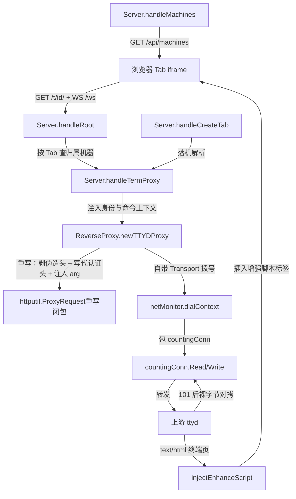

# 终端反代与多上游接入知识库（Terminal Proxy Knowledge Base）

Current standalone requirements are authoritative in [architecture](ARCHITECTURE.md) and [deployment](DEPLOYMENT.md): local passkeys and SQLite are defaults; PostgreSQL, external authentication and wake/presence are optional. Earlier fleet-specific examples below are historical context. Server session, proxy, tab and preset handlers now reside in separate files.
> 产品北极星：shell-gate 是自托管浏览器终端门禁：经通行密钥登录后进多 Tab 工作台，
> 每个 Tab 独立反代一台上游 ttyd（可配多台机器），门禁负责鉴权、命令注入、响应改写与可观测性。
> 本域覆盖：门禁如何注册多台上游机器、为每台持有独立反代与监控器、把浏览器流量转发到受信上游 ttyd，
> 以及相关配置 fail-fast 与安全加固。
> 正文使用业务概念正词；实现别名仅在首次出现处括号标注，并在入口索引中列出。

## §0 Contents

| 节 | 标题 | 内容摘要 |
|---|------|---------|
| §1 | 领域概览与业务概念 | 机器、门禁、上游 ttyd、命令包装、代认证头、增强脚本的定义与关系 |
| §1.5 | 分层调用图 | 浏览器→门禁反代→上游 ttyd 的分层调用 mermaid 图 |
| §2 | 机器注册与配置解析 | 机器（machine）列表解析、默认机、fail-fast 规则、探测与会话时长配置 |
| §2.5 | 物理路径索引 | 本域实现的完整相对路径表 |
| §3 | 场景入口 | 开 Tab 落机、终端反代建连、机器目录查询三类场景的入口函数 |
| §4 | 数据说明 | 本域无专属表声明 |
| §5 | 反代链路详解 | 反代重写、命令包装、响应改写、字节统计、探测身份、帧约束 |
| §6 | 约束与禁令 | 安全与正确性禁令（含 AI pitfall） |
| §7 | 可执行验证 | 真连验 101 握手与回归测试命令 |
| §8 | 相关域与跨域约束 | 相邻域的归属声明与本域对其的约束 |
| §9 | 缺口、勘误与置信度 | 未确认项、已知条目勘误、用户输入缺失声明 |

## §1 领域概览与业务概念

门禁（shell-gate，`cmd/shell-gate`）是浏览器与上游 ttyd（上游伪终端服务，ttyd 1.7.7）之间的唯一网关。
浏览器永远不直连上游 ttyd；所有终端流量先经过门禁的会话鉴权，再由门禁按 Tab 归属的机器转发到对应上游。

业务概念正词表（全文统一使用左列，右列实现别名仅首次出现处标注）：

| 业务概念 | 正文用词 | 实现别名 |
|---|---|---|
| 上游终端主机 | 机器 | machine，`SHELL_TTYD_TARGETS` 名 |
| 门禁 | 门禁 | shell-gate，`cmd/shell-gate` |
| 上游伪终端服务 | 上游 ttyd | ttyd 1.7.7 |
| 启动命令包装 | 命令包装 | `interactiveLoginCommand` |
| 代认证头 | 代认证头 | `X-Webauth-User` |
| 终端增强脚本 | 增强脚本 | `enhance.js` |

核心关系：

- 一台机器（machine）对应一个上游地址。门禁启动时为每台机器各建一个独立反代与一个独立监控器，
  实现见 `Server.initUpstreams()`（`internal/server/server.go`）。一台机器的探测超时不拖累另一台的转发，
  这是多上游设计的隔离性要求（来源：`docs/design/2026-08-24-multi-upstream.md` §4.1）。
- 一个 Tab 在创建时就固定归属到一台机器（`POST /api/tabs` 的落机解析，见 §3），之后该 Tab 的全部
  `/t/{id}/` 流量都走归属机器的反代（`Server.handleTermProxy()` 按 `tab.Machine` 查 `upstreamByName`）。
- 代认证头（`X-Webauth-User`）是门禁向上游证明"此请求已鉴权"的唯一凭证。上游 ttyd 以 `-H X-Webauth-User`
  方式启动鉴权；门禁先剥掉客户端可能伪造的同名头，再写入门禁已校验的登录邮箱（`newTTYDProxy()` 的重写函数）。
  代认证头的身份值来源是门禁会话（登录邮箱），登录流程本身归认证域，本域只消费结果。
- 命令包装（`interactiveLoginCommand`）保证"快捷命令与用户手敲效果完全一致"：把预置或自定义启动命令
  包成登录交互壳执行，跑完落回交互壳（`exec "$SHELL" -li`）。
- 增强脚本（`enhance.js`，`internal/server/web/enhance.js`，经 `go:embed` 编入 `Server` 所在二进制）
  由门禁在反代响应改写阶段注入到上游返回的终端页面中，负责中文标点修复、剪贴板桥接、手机键盘避让、
  回显计时等浏览器侧能力。脚本的具体行为归前端/可观测域，本域只负责"注入"这一动作。

机器是部署级配置：新增一台机器意味着先装好上游（ttyd 启动方式、托管 keepalive、登录壳插件、门禁网络可达），
再改门禁环境变量重启生效。机器列表不进界面管理（来源：`docs/design/2026-08-24-multi-upstream.md` §9）。

## §1.5 分层调用图



说明：

- `Server.handleRoot()`（`internal/server/server.go`）是 `/t/` 前缀流量的统一入口，鉴权后委托给
  `Server.handleTermProxy()`（`internal/server/tab_handlers.go`）。
- `newTTYDProxy()`（`internal/server/proxy.go`）返回的反代实例按机器持有，重写闭包负责代认证头与命令注入，
  `Transport` 的拨号入口为 `netMonitor.dialContext()`（`internal/server/netmon.go`）。
- `injectEnhanceScript()`（`internal/server/proxy.go`）只处理上游返回的 `text/html` 响应；
  WebSocket 升级成 101 之后的终端字节流走 `countingConn`（`internal/server/netmon.go`）对拷统计，
  响应改写钩子看不到这些字节（见 §5.4）。
- `Server.handleMachines()`（`internal/server/server.go`）与 `Server.handleCreateTab()`
  （`internal/server/tab_handlers.go`）分别是机器目录查询与落机写入的入口。

## §2 机器注册与配置解析

### 2.1 环境变量与优先级

- 多机器用 `SHELL_TTYD_TARGETS`（逗号分隔的 `名称=地址`，如
  `linux=http://terminal.example.com:7681,tokyo=http://extra-terminal.example.com:7681`）。
- 未配置时回退旧的单值 `SHELL_TTYD_URL`，机器名固定为 `default`；单机部署升级后行为不变。
- 解析入口为 `parseMachines()`（`internal/server/config.go`），由 `Config.ConfigFromEnv()` 调用。
- 列表顺序即展示顺序，第一台是默认机器；`Config.DefaultMachineName()` 返回列表首台，
  空列表时回落 `default` 常量。

### 2.2 机器名规则与 fail-fast

机器名规则由 `validMachineName()`（`internal/server/config.go`）判定：1~16 位，
仅允许字母、数字、下划线、连字符。以下情况全部启动失败，不静默丢弃：

- 机器名非法（含空格、超长、非法字符）；
- 机器名重复；
- 机器地址非法（见 §2.3）；
- `SHELL_TTYD_TARGETS` 与 `SHELL_TTYD_URL` 都没配；
- `SHELL_TTYD_TARGETS` 解析后为空（如全是空白逗号段）。

守卫测试为 `TestParseMachines()`（`internal/server/server_test.go`），覆盖多目标顺序保留、
单值回退、重名/非法名/非法地址/空配置的 fail-fast，以及 `file://`、`ftp://`、
含 userinfo 地址的拒绝与大写 scheme 规范化。

### 2.3 上游地址校验

上游地址校验由 `parseUpstreamURL()`（`internal/server/config.go`）执行：

- 只允许 `http`/`https`（大小写不敏感，统一规范化为小写）；
- 必须有 Host；
- 禁止 URL 内嵌用户名密码（userinfo）；
- 禁止携带 query 与 fragment。

上游是门禁信任边界内的 ttyd，协议与凭证形态写死，避免 `file`/`unix` 等 scheme 或 userinfo
被误配进反代。来源口径见 `docs/troubleshooting/2026-09-05-gate-policy-hardening.md` 结论第 2 条。

### 2.4 探测身份

`Config.probeIdentity()`（`internal/server/config.go`）返回白名单邮箱中字典序最小的一个，
保证每次重启口径一致。该值经 `Server.initUpstreams()` 传入每台机器的
`newNetMonitor()`，作为上游健康探测携带的代认证头取值（见 §5.5）。
守卫测试为 `TestConfigProbeIdentityIsStable()`（`internal/server/server_test.go`）。

### 2.5 时长类配置的 fail-fast

与本域相关的两项时长同样 fail-fast（来源口径同 §2.3 的加固文档结论第 3 条）：

- `SHELL_SESSION_TTL` 经 `parsePositiveDuration()` 解析：非法或 `<=0` 启动失败，禁止静默回落默认。
  Cookie `MaxAge` 与门禁自签会话 JWT 的 `exp` 都由它控制。
- `SHELL_NETMON_INTERVAL` 经 `parseNonNegativeDuration()` 解析：非法或负值启动失败；
  `0` 合法，表示只做被动统计、不发探测包。
- 守卫测试为 `TestParseSessionAndNetmonDurations()`（`internal/server/server_test.go`）。

## §2.5 物理路径索引

| 项目根起的完整相对路径 | 内容 |
|---|---|
| `internal/server/proxy.go` | 反代主体：`newTTYDProxy()` 重写与 Transport、`interactiveLoginCommand()` 命令包装、`ansiCQuote()` 转义、`injectEnhanceScript()` 响应改写 |
| `internal/server/server.go` | `upstream` 结构与 `Server.initUpstreams()` 每机实例化、`Server.handleMachines()` 机器目录、`Server.handleRoot()` 路由与帧约束、增强脚本嵌入 |
| `internal/server/config.go` | `parseMachines()` 与 `parseUpstreamURL()` 上游解析校验、`Config.probeIdentity()` 探测身份、`Config.DefaultMachineName()` 默认机、`parsePositiveDuration()` 与 `parseNonNegativeDuration()` 时长 fail-fast |
| `internal/server/tab_handlers.go` | `Server.handleCreateTab()` 落机解析（预置绑定大于请求指定大于默认机）、`Server.handleTermProxy()` 按归属机器路由 |
| `internal/server/netmon.go` | `netMonitor.dialContext()` 拨号与握手采样、`countingConn` 双向字节统计、探测请求携带代认证头 |
| `internal/server/adapters.go` | `TerminalBackend` 反代边界接口（已鉴权请求才能进入终端后端） |
| `docs/design/2026-08-24-multi-upstream.md` | 多上游机器支持设计全文（配置模型、服务端设计、验收清单） |
| `docs/troubleshooting/2026-09-05-gate-policy-hardening.md` | 门禁放行与配置加固结论（环境代理禁令、地址校验、时长 fail-fast） |

## §3 场景入口

### 场景一：创建 Tab 并确定落机（预置绑定大于请求指定大于默认机）

入口：`Server.handleCreateTab()`（`internal/server/tab_handlers.go`，`POST /api/tabs`）。

1. 取请求体 `machine` 字段；为空则用 `Config.DefaultMachineName()`。
2. 若带 `presetId`，读取预置；预置的绑定机器非空时覆盖上一步结果。
3. 用 `Config.machineExists()` 校验最终机器名，不存在返回 400。
4. 按归属机器查 `upstreamByName`，创建 Tab 记录并返回 `path`（`/t/{id}/`）。
5. 唤醒与租约动作属于相邻域（Mac 唤醒/租约），本域只保证"落机解析"本身。
守卫测试：`TestCreateTabRoutesToMachine()`（`internal/server/server_test.go`）。

### 场景二：浏览器流量反代到归属机器的上游 ttyd

入口：`Server.handleRoot()`（`internal/server/server.go`）→ `Server.handleTermProxy()`
（`internal/server/tab_handlers.go`，路径 `/t/{id}/…`）。

1. 从路径取出 Tab ID，按登录邮箱查归属并鉴权（非本人返回 404，避免泄露存在性）。
2. 无尾部斜杠的文档请求补 `/` 重定向，保证 ttyd 前端能拼出正确的 `/t/{id}/ws`。
3. 按 `tab.Machine` 查 `upstreamByName`；机器已从配置移除则返回 502（与上游宕机同表现，不做路由迁移）。
4. 把登录邮箱与 Tab 启动命令分别经上下文键写入请求，再交归属机器的反代实例处理；
   反代重写层据此注入代认证头与 `arg`（见 §5.1）。
守卫测试：`TestProxyRewriteInjectsTrustedAuthHeaderAndCommand()`、
`TestProxyInjectsArgForEmptyCommand()`（`internal/server/server_test.go`）。

### 场景三：客户端获取机器目录

入口：`Server.handleMachines()`（`internal/server/server.go`，`GET /api/machines`，需登录）。

- 返回全部上游机器条目：展示名、目标 Host、是否默认机、健康态、连续失败计数、是否可唤醒。
- 机器目录由服务端下发，客户端不内置任何机器名；服务端新增机器后客户端无需发版即可见。
- 未登录返回 401：机器目录虽是展示数据，但包含内网拓扑信息。
守卫测试：`TestMachinesEndpoint()`（`internal/server/server_test.go`）。

## §4 数据说明

本域无专属表；机器目录为内存加配置派生，Tab 归属见 Tab KB。

- 机器列表来自环境变量解析后的 `Config.Machines`（`internal/server/config.go`），
  经 `Server.initUpstreams()` 物化为内存中的 `upstream` 切片与按名索引，
  列表变化需重启门禁生效。
- 健康态、失败计数等机器目录字段来自各机器独立监控器的运行时状态，非持久化表。
- Tab 的归属机器与启动命令持久化在 Tab 目录中，其表结构与生命周期归 Tab 服务端记忆域，
  本域只读 `tab.Machine` 与 `tab.Command` 做路由与注入。

## §5 反代链路详解

### 5.1 请求重写：身份与命令注入

`newTTYDProxy()`（`internal/server/proxy.go`）的 `Rewrite` 闭包对每个进入反代的请求执行：

1. 按目标机器地址重写 URL 与 Host。
2. 先删除客户端可能伪造的代认证头（含大小写变体）以及 `Cookie`、`Authorization`，
   再写入门禁已校验的登录邮箱。顺序不可颠倒：先剥后写是防止伪造身份直达上游的关键。
3. 删除客户端自带的 `arg` 查询参数，避免任意命令注入；再以服务端持有的 Tab 启动命令
   经 `interactiveLoginCommand()` 包装后写入 `arg`。
4. 空命令（「＋ shell」）同样注入包装结果：上游无参脚本会开 `bash -l`，机器默认壳是 zsh 时会进错壳，
   因此空命令也必须带 `arg`。
5. 强制上游响应的 `Accept-Encoding` 为 `gzip`，与 §5.3 的解压/重压缩路径配套。

### 5.2 命令包装：登录交互壳、收尾与转义

`interactiveLoginCommand()`（`internal/server/proxy.go`）的包装规则：

- 非空命令包成 `exec "$SHELL" -lic <ANSI-C 引用命令>`，其中被引命令为
  `原命令 + 换行 + exec "$SHELL" -li`。
- 末尾追加 `exec "$SHELL" -li` 让快捷命令跑完落回交互壳：终端页面的唯一进程就是这个 shell，
  它一退出 ttyd 即关闭 WebSocket，而浏览器恢复层会重载页面并重新注入同一启动命令，
  会正常结束的一次性命令将陷入"跑完—断开—重连—再跑"的死循环（来源见该函数注释，2026-08-02 实测）。
- 收尾用换行拼接而不用 `;`：避免原命令以注释或后台符号结尾时吞掉收尾语句。
- 必须用 `$SHELL` 而禁止写死 `bash`：机器默认壳可能是 zsh，写死会导致整段跑在 bash 里、
  看不到账号配置的提示符与插件；`$SHELL` 本就是 bash 的机器行为与旧写法一致。
- 换行必须由 bash/zsh 自己从 ANSI-C 引用展开，URL 里只出现反斜杠加 `n` 两个普通字符；
  `arg` 里出现真实换行（`%0A`）会导致上游依赖的 libwebsockets 判握手失败，
  门禁侧表现为反代 EOF、浏览器 502（来源见该函数注释，2026-08-03 实测）。
- 转义由 `ansiCQuote()` 承担：反斜杠、单引号转义，换行与回车写成 `\n`、`\r` 两字符。
  选用 ANSI-C 引用而不用普通单引号的原因是普通单引号无法表达换行。
- 自 2026-09-05 起不再导出网页会话标记，网页端默认还原本机插件，接受回显变慢；
  禁止为流畅度重新引入跳过插件的写法。

守卫测试：`TestInteractiveLoginCommandQuoting()`、`TestInteractiveLoginCommandUsesLoginShell()`、
`TestInteractiveLoginCommandKeepsShellAlive()`、`TestInteractiveLoginCommandHasNoRawControlChars()`
（`internal/server/server_test.go`）。

### 5.3 响应改写：增强脚本注入

`injectEnhanceScript()`（`internal/server/proxy.go`）只处理 `Content-Type` 含 `text/html` 的上游响应，
非 HTML 原样放行：

- 读取响应体；若 `Content-Encoding` 为 `gzip` 则先解压，解压失败原样放行、不打断终端页加载。
- 用 `insertBeforeBodyClose()` 把增强脚本标签插到 `</body>` 之前（大小写不敏感查找）；
  找不到闭合标签则追加到末尾，保证脚本总能加载。
- 若原响应为 gzip 则重压缩，并同步更新 `Content-Length`（数值字段与 Header 两处）。
- 注入的标签为常量增强脚本标签（`internal/server/server.go`），指向同源的 `/__shellgate/enhance.js`，
  由 `Server.handleEnhanceJS()` 提供，避免跨域限制。

守卫测试：`TestInjectEnhanceScriptPlainHTML()`、`TestInjectEnhanceScriptGzipHTML()`、
`TestInjectEnhanceScriptSkipsNonHTML()`（`internal/server/server_test.go`）。

### 5.4 传输层与字节统计：拨号采样与 `countingConn`

`newTTYDProxy()` 自带 `Transport`（`internal/server/proxy.go`），要点：

- 拨号函数为归属机器监控器的 `netMonitor.dialContext()`（`internal/server/netmon.go`）：
  每次真实建连的耗时记成握手时延样本，并把连接包成 `countingConn` 做双向字节统计。
- `ForceAttemptHTTP2` 必须为 `false`：WebSocket 升级只能走 HTTP/1.1。
- 代理字节必须在 `net.Conn` 层统计：上游走 WebSocket，101 之后反代退化成裸字节对拷，
  `ModifyResponse` 类响应钩子完全看不到终端流量。因此拨号包装是统计转发放量的唯一位置。
- `countingConn`（`internal/server/netmon.go`）刻意不实现 `ReadFrom`/`WriteTo`：
  这两个快路径会绕开 `Read`/`Write` 直接搬字节，统计会漏数。
- `countingConn` 必须转发 `CloseWrite`：反代靠它做 TCP 半关闭，吞掉会导致上游收不到 EOF。
- 并发模式：字节与连接计数用原子计数，连接集合与时延窗口用互斥锁保护；
  探测客户端不用计数拨号器，避免探测流量混进业务吞吐统计。

守卫测试：`TestNetmonCountsProxiedTrafficAndHandshake()`、
`TestCountingConnForwardsCloseWrite()`（`internal/server/server_test.go`）。

### 5.5 上游探测的身份要求

上游 ttyd 以 `-H X-Webauth-User` 鉴权；探测请求不带代认证头只会拿到 407，
量到的是"被拒绝"的耗时，走不到真实处理路径。因此监控器的探测请求必须携带
`Config.probeIdentity()` 给出的邮箱（`internal/server/netmon.go` 探测构造处）。
守卫测试：`TestNetmonProbeCarriesTrustedIdentity()`（`internal/server/server_test.go`）。

任一上游健康翻转（`healthy()` 真值变化）时经 `onHealthChange` 回调重估全局：
进入「全部机器同时不可用」记一行（含机器名），恢复再记一行，单台抖动不打扰。
多台同时失联几乎不可能是多台上游同时宕机——2026-10-21 实测是门禁边缘到上游的
整条覆盖网单向中断，而两台上游本身都活着；这行日志就是为这种情况指方向。
`GET /api/machines` 条目另带 `lastError`（最近探测错误文本，健康时为空），
便于在面板或 `curl` 里直接区分超时 / 拒绝 / 407。
守卫测试：`TestRecordProbeFlipsHealthHook()`、`TestAllUpstreamsDownNotifiesOnce()`、
`TestMachinesEndpointShowsLastError()`（`internal/server/server_test.go`）。

### 5.6 帧约束：工作台与终端页不得互相嵌套

- 工作台与登录页响应头带 `frame-ancestors 'none'`（`denyFraming()`，
  `internal/server/server.go`），并对 `Sec-Fetch-Dest` 为 `iframe`/`embed`/`object` 的
  `/` 请求直接返回 403（`isEmbeddedDocumentRequest()` 判定）。
- 背景：Tab 的 `path` 为空时 iframe 地址会退化成 `?rendererType=…`，浏览器解析成 `/?…`，
  从而在终端 iframe 里再画一套顶栏（双层顶栏）。终端挂载只接受 `/t/{id}/`。
- 守卫测试：`TestRootRejectsIframeEmbedding()`、`TestLoginDeniesFraming()`、
  `TestWorkspaceHTMLGuardsAgainstNestedShellAndInvalidTabPath()`、
  `TestRootServesWorkspaceWithCanvasRendererQuery()`（`internal/server/server_test.go`）。

## §6 约束与禁令

1. **AI pitfall：反代 Transport 禁止使用环境代理。** `newTTYDProxy()` 的 `Transport.Proxy`
   必须为 `nil`，禁止 `ProxyFromEnvironment`。上游是信任边界内的内网 ttyd，走环境代理会把
   代认证头与终端流量送到外部代理，属于放行策略错误。守卫测试为
   `TestTTYDProxyTransportDoesNotUseEnvProxy()`。来源口径见
   `docs/troubleshooting/2026-09-05-gate-policy-hardening.md` 结论第 1 条。
2. **AI pitfall：上游地址禁止 URL 内嵌用户名密码，且只允许 http/https。**
   所有上游地址必须经过 `parseUpstreamURL()` 校验；禁止 `file`、`ftp` 等 scheme，
   禁止 userinfo，禁止 query 与 fragment，scheme 统一小写。机器名拼错、重复、非法一律启动失败。
3. **注入给上游的 `arg` 里禁止出现真实换行等控制字符。** 命令包装的换行只能是 ANSI-C 引用中的
   `\n` 两字符，由远端 shell 展开；真实换行（`%0A`）会导致握手失败、带命令的 Tab 全部 502。
   改动命令包装后必须真连一次上游验 101（见 §7），不能只跑单测。
   守卫测试为 `TestInteractiveLoginCommandHasNoRawControlChars()`。
4. **命令包装禁止写死 `bash -lic`。** 必须用 `exec "$SHELL" -lic`，否则默认壳为 zsh 的机器
   点预置会整段跑在 bash 里，看不到账号插件；空命令也必须注入 `arg`，否则上游脚本开 `bash -l`、
   进不了默认壳。守卫测试为 `TestInteractiveLoginCommandUsesLoginShell()` 与
   `TestProxyInjectsArgForEmptyCommand()`。
5. **改动 Transport 后必须真连一次验证 101 握手。** 单测覆盖不到升级路径；
   用 §7 的 `curl` 升级请求确认握手码为 101，且 `arg` 无控制字符。
6. **请求重写必须先剥客户端伪造头再写服务端身份。** 顺序为：删客户端的代认证头（大小写变体）、
   `Cookie`、`Authorization`，再写门禁已校验邮箱；删客户端 `arg` 后再写服务端包装命令。
   两项顺序颠倒分别对应身份伪造与任意命令注入。
7. **`countingConn` 禁止实现 `ReadFrom`/`WriteTo`，必须转发 `CloseWrite`。**
   前者绕开统计，后者影响反代半关闭；改动后跑 `TestCountingConnForwardsCloseWrite()`。
8. **上游探测必须携带代认证头。** 不带只会拿到 407，监控面板看到的是"被拒绝"的耗时而非真实处理路径。
   探测身份取白名单字典序最小邮箱，保证重启后口径一致。
9. **工作台与登录页禁止被嵌进终端 iframe。** 必须保留帧祖先禁令与嵌入请求拦截；
   终端挂载只接受 `/t/{id}/`，`path` 为空的挂载属于双层顶栏缺陷。
10. **机器是部署级配置，不进界面管理。** 新增机器先备齐上游（鉴权启动、托管 keepalive、
    登录壳插件、门禁网络可达）再改环境变量重启；机器名拼错直接启动失败，不静默丢弃。

## §7 可执行验证

### 验证一：真连上游验 101 握手（改动命令包装或 Transport 后必做）

用占位地址 `upstream-host:7681`（替换为实际机器的 Host 与端口），`TAB-ARG` 替换为
`interactiveLoginCommand()` 实际产出的 `arg` 值：

```bash
curl -i -N \
  -H "Connection: Upgrade" \
  -H "Upgrade: websocket" \
  -H "Sec-WebSocket-Version: 13" \
  -H "Sec-WebSocket-Key: $(openssl rand -base64 16)" \
  -H "X-Webauth-User: operator@example.com" \
  "http://upstream-host:7681/ws?arg=TAB-ARG"
```

- 期望首行握手码为 `101`；若看到 `407` 说明代认证头缺失或身份不对，先查头注入而非网络。
- 若看到 `502` 或握手失败，优先检查 `arg` 是否含真实换行等控制字符（`%0A` 禁令，见 §6 第 3 条），
  再查上游进程与端口监听。
- 本机回环验证时不要用"本机连自己的公网地址不通"当故障判据；应在 `127.0.0.1` 另起 ttyd 实例指向验证。
- 手敲启动 ttyd 时 `-t rendererType=canvas` 必须写成一个参数，拆成两个参数会直接报无效客户端选项退出。

### 验证二：回归测试

```bash
go test -race ./...
```

- 至少确认以下守卫测试通过：`TestParseMachines()`、`TestTTYDProxyTransportDoesNotUseEnvProxy()`、
  `TestInteractiveLoginCommandHasNoRawControlChars()`、`TestProxyRewriteInjectsTrustedAuthHeaderAndCommand()`、
  `TestInjectEnhanceScriptPlainHTML()`、`TestInjectEnhanceScriptGzipHTML()`、
  `TestCountingConnForwardsCloseWrite()`、`TestNetmonProbeCarriesTrustedIdentity()`、
  `TestRecordProbeFlipsHealthHook()`、`TestAllUpstreamsDownNotifiesOnce()`、
  `TestMachinesEndpointShowsLastError()`、`TestMachinesEndpoint()`、`TestCreateTabRoutesToMachine()`、
  `TestRootServesWorkspaceWithCanvasRendererQuery()`、
  `TestWorkspaceHTMLHasNetmonEntryAndResponsiveTopBar()`。
- 回归通过不替代验证一：握手升级路径只有真连才能覆盖。

## §8 相关域与跨域约束

- Tab 服务端记忆：Tab 的归属机器与启动命令由该域持久化，本域只读 `tab.Machine` 与 `tab.Command`。
  跨域约束：落机解析的优先级（预置绑定大于请求指定大于默认机）由本域定义，Tab 域不得在恢复时改写归属；
  机器从配置移除后存量 Tab 按 502 处理，不做路由迁移（来源：`docs/design/2026-08-24-multi-upstream.md` §4.2）。
- 浏览器工作台前端：终端 iframe 只接受 `/t/{id}/` 挂载；工作台与登录页保持帧祖先禁令。
  跨域约束：前端不得内置机器名，机器目录只从 `GET /api/machines` 拉取；只有一台机器时机器选择器等
  多机器界面元素全部不渲染。
- 网络监控：`countingConn` 的被动字节统计与拨号握手采样是监控域上行段的数据来源；
  探测请求必须携带代认证头（见 §5.5）。跨域约束：采样口径、面板形态归监控域，
  本域只保证统计位置（`net.Conn` 层）与探测身份正确。
- 认证与会话（backlog）：代认证头的身份值来源是门禁会话的登录邮箱；会话时长的 fail-fast
  口径在本域 §2.5 引用，完整登录流程归认证域。
- 双边缘部署（backlog）：共享存储不影响反代拓扑；每台门禁实例独立按自身 `SHELL_TTYD_TARGETS`
  构建反代，上游地址与机器名在各实例保持一致即可。

## §9 缺口、勘误与置信度

- Missing user experience input（用户禁止提问，未做 Intake/Q&A；以下标 Low confidence）：
  - 真实多机器部署中"机器选择器 pill + Tab 按机过滤"的操作负担未做用户访谈；
    单机用户对"无选择器零变化"的实际感知未验证。
  - 上游新增机器时的部署清单执行顺序（先装 ttyd 还是先配门禁）在本机未走完一遍，
    相关步骤置信度标 Low。
- 勘误（以代码实测为准，已修正任务输入中的不准确处）：
  - 任务"已知条目"称上游 URL 校验在 `internal/server/security.go`，实际校验函数
    `parseUpstreamURL()` 位于 `internal/server/config.go`；`internal/server/security.go`
    实际内容为会话密钥加载与请求来源/跨站保护（`protectRequests()`），High confidence。
  - `Server.handleTermProxy()` 实际位于 `internal/server/tab_handlers.go` 而非 `server.go`，
    High confidence。
  - `denyFraming()` 与 `isEmbeddedDocumentRequest()` 实际位于 `internal/server/server.go`，
    High confidence。
- 已确认写入正文的深度信号：
  - 并发：`countingConn` 字节与连接计数用原子计数，连接集合与时延窗口用互斥锁保护；
    探测客户端禁用连接复用且不走计数拨号器，避免探测流量污染业务统计（`internal/server/netmon.go`）。
  - 高频改动区：`internal/server/server.go` 与 `internal/server/config.go` 为多机器与加固逻辑的集中点，
    改动反代、机器解析、时长配置时优先回归本文件相关测试。
  - 隐藏机制：Transport 自定义拨号兼握手采样；`ModifyResponse` 只能见到 HTTP 响应头、
    见不到 101 之后的终端字节流；上游 ttyd 以 `-H X-Webauth-User` 鉴权，不带只回 407。
- 已丢弃的误导性候选：无。本轮未发现与"已知条目"冲突且需丢弃的深度信号；
  `security.go` 的归属问题属文件定位勘误而非信号真伪问题，已在上条记录。
- 未编造项声明：未编造历史事故经过与性能数字；引用的 407、101、`%0A` 握手失败、
  一次性命令重连死循环等均来自代码注释与 `docs/design/2026-08-24-multi-upstream.md`、
  `docs/troubleshooting/2026-09-05-gate-policy-hardening.md` 的已有实测记录。
