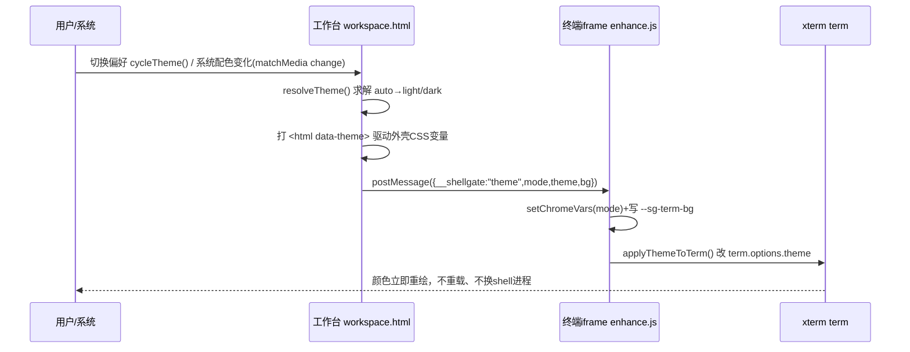
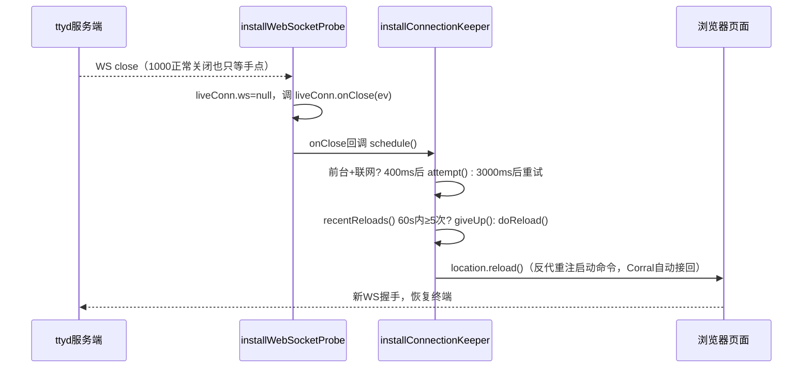

# 浏览器工作台前端知识库（WORKSPACE_FRONTEND_KNOWLEDGE_BASE）

Current standalone requirements are authoritative in [architecture](ARCHITECTURE.md) and [deployment](DEPLOYMENT.md): local passkeys and SQLite are defaults; PostgreSQL, external authentication and wake/presence are optional. Earlier fleet-specific examples below are historical context. Server session, proxy, tab and preset handlers now reside in separate files.
> 领域：工作台外壳与终端增强脚本的全部前端行为。真相源文件为
> `internal/server/web/workspace.html`（工作台）与
> `internal/server/web/enhance.js`（增强脚本）。
> 本文档只收录前端行为与契约；服务端反代/配置/会话、netmon 服务端采样、
> Mac 唤醒链路只写到"前端约定的 URL 参数与 postMessage 契约"为止，
> 细节各自归属对应领域文档。结论复用下列设计与排查记录，不重写：
> `docs/design/frontend-redesign.md`、
> `docs/troubleshooting/2026-08-05-terminal-echo-latency.md`、
> `docs/troubleshooting/2026-08-20-tui-display-corruption.md`、
> `docs/troubleshooting/2026-09-08-double-title-bar-nested-workspace.md`。

## §0 领域速览（10 行）

| # | 条目 | 内容 |
|---|------|------|
| 1 | 北极星 | 自托管浏览器终端门禁：登录后进多 Tab 工作台，终端画面由 ttyd 渲染、门禁注入的增强脚本负责贴边、主题、键盘、剪贴板、断线恢复与可观测 |
| 2 | 外壳真相源 | `internal/server/web/workspace.html` 是顶栏/Tab 条/主题/键盘高度/菜单/悬浮小窗的唯一负责人 |
| 3 | 增强脚本真相源 | `internal/server/web/enhance.js` 只在存在 `window.term` 的终端页生效，其余 HTML 静默跳过 |
| 4 | 顶栏铁律 | 单行紧凑：机器 pill＋启动器 \| Tab 条（占余量横滚）\| 浅色/网络/预置；Tab 增多只横向滚动，禁换行撑高 |
| 5 | 主题铁律 | 父页唯一真相源，三档 `auto`/`light`/`dark`，`postMessage` 广播，iframe 内禁自算、禁重载换肤 |
| 6 | 键盘铁律 | `workspace.html` 用 `visualViewport` 独占高度管理，首次升起锁 `--app-height`，键盘开合禁改行列 |
| 7 | 贴边铁律 | `tightFitTerminal()` 指纹＝容器盒＋`cols`/`rows`＋`.xterm-screen` 尺寸，量前先清 `transform` |
| 8 | 渲染器策略 | 默认 `?rendererType=canvas`，中文正确优先于 WebGL 约 44ms 绘制收益；`preserveDrawingBuffer` 猴补丁保留作双保险 |
| 9 | 断线恢复 | `disableReconnect=true` 关 ttyd 自带，`installConnectionKeeper()` 以 `location.reload()` 统一恢复，60s/5 次护栏 |
| 10 | 回显口径 | 安静门槛 80ms 起表，`isTerminalQueryOnlyFrame()` 排除查询帧，`ECHO_ATTRIBUTION_MS`(600ms) 丢弃无归因样本 |

## §1 业务概念与正文用词

| 业务概念 | 正文用词 | 实现别名 | 说明 |
|---|---|---|---|
| 工作台 | 工作台 | `workspace.html` | 登录后的多 Tab 外壳页，含顶栏/舞台/菜单/悬浮小窗/预置对话框 |
| 终端增强脚本 | 增强脚本 | `enhance.js` | 反代注入 ttyd 页面的脚本，`waitForTerm()` 就绪后装配各模块 |
| 顶栏 | 顶栏 | `.top`/`.top-shell`、`#launchers` | 单行启动器＋Tab 条＋工具轨；窄屏收纳为 ☰/Tab/⋯ |
| 贴边 | 贴边 | `tightFitTerminal()`、`tightFitStateKey()` | 把字符网格铺满容器，骗 FitAddon＋补列行＋半格 scale |
| 断线恢复 | 断线恢复 | `installConnectionKeeper()` | 前台＋联网即 `location.reload()` 重连，护栏超限转手动 |
| 快捷键栏 | 快捷键栏 | 两行×6 键、`MOBILE_TOOLBAR_MIN_HEIGHT` | 触摸优先设备专属，`pointerdown` 保焦、`pointerup` 发送 |
| 深浅色主题 | 主题 | `TERM_THEME_DARK`/`TERM_THEME_LIGHT`、`shellgate_theme_pref` | 父页解出生效档位并广播，iframe 运行时换肤 |
| 键盘高度 | 键盘高度 | `--app-height`、`syncAppViewport()` | 父页 `visualViewport` 压整页高度，锁住后只跟矮不跟回弹 |
| 回显计时 | 回显计时 | `installWebSocketProbe()`、`createRttTracker()` | 单时钟往返：发出输入帧到收到下一帧输出 |
| 手术刀复制 | 外复制双路径 | `installClipboardBridge()`、`installManualSelectionCopy()` | OSC 52 主动复制 vs 用户拖选后复制，两条独立路径 |

正文统一使用左列"正文用词"；实现别名只在括号或代码引用中出现。

## §1.5 关键序列（mermaid）

### 主题广播序列：父页真相源 → 全 Tab 运行时换肤



要点：首帧配色不走广播，走 `mountTabPane()` 拼 iframe 地址时带的
`theme=` 查询参数，由 `parseInitialTheme()` 解出，避免先深后浅的闪烁；
广播晚到时 `applyThemeToTerm()` 在 `term` 就绪前先攒 `_pendingTermTheme`，
`waitForTerm()` 回调里补做。

### 断线恢复序列：ttyd 自带关闭 → 增强脚本接管



要点：`disableReconnect=true` 与 `installConnectionKeeper()` 是一对，
去掉任一侧要么退回"要手点"、要么两套重连打架；超限后 `giveUp()`
写一行黄色提示并用 `{once:true}` 的 `pointerdown`/`keydown` 等用户手动重连。

## §2 外壳结构（`internal/server/web/workspace.html`）

### §2.1 单行顶栏

- DOM 顺序即视觉顺序：`#btnLaunchMenu`(☰，窄屏) → `#machines` →
  `#launchers` → `#tabs` → `#rail`(浅色/网络/预置) → `#btnMoreMenu`(⋯，窄屏)。
- `.top` 必须 `flex-wrap:nowrap`＋`overflow:hidden`。`overflow-x:auto` 会把
  `overflow-y` 从 `visible` 变成 `auto`，进而把顶栏撑高抖动，所以横向滚动
  只许出现在 `.tabs` 上，`.top` 本体保持 `hidden`。
- `.tabs` 用 `flex:1 1 0%` 吃掉全部余量，`0%` 基长保证左右控件占满时余量
  正确让给横向滚动而不是把整行撑高；滚动条隐藏（`scrollbar-width:none`）。
- `.tab` 固定 `height:28px`、`flex-shrink:0`、`max-width:160px`，标题省略；
  新 Tab 用 `scrollIntoView({block:"nearest",inline:"nearest"})` 滚进可见区。
- 机器 pill（`.mach`）与启动器按钮（`.launch`）都是描边＋透明底，
  禁用渐变填充；只有一台机器时 `#machines` 整体不渲染
  （`renderMachines()` 早退＋`.machines:empty{display:none}`），
  预置对话框的机器下拉（`#presetMachineField`）同步 `hidden`。
- 视觉细则（间距/字号/品牌字缺席/无退出按钮）复用
  `docs/design/frontend-redesign.md`，本库不再重写。

### §2.2 顶栏即启动器，窄屏同源收纳

- `renderLaunchers()` 把"＋ shell"＋全部预置平铺进 `#launchers`，
  点一下经 `openTab()` 直接开 Tab；已删除"先点开再选"的"新开"弹窗，
  不要加回任何中间层。
- 窄屏（`max-width:760px`）隐藏 `.machines/.launchers/.rail`，改走左右菜单：
  左 ☰（`#launchMenu`：机器＋启动项）与右 ⋯（`#moreMenu`：主题/网络/修复显示/
  预置）。两处菜单与顶栏平铺渲染同一份数据（`renderLaunchers()`/
  `renderMachines()` 双写），仍是一层直达，不违反"不要二级菜单"。
- 菜单必须挂在 `.top-shell` 上、与 `.top` 兄弟（`#launchMenu`/`#moreMenu`
  均在 `header.top` 之外）。`.top` 的 `overflow:hidden` 会把写在其内部的
  绝对定位下拉裁掉，点 ☰/⋯ 只亮透明遮罩、像按钮全坏。
  守卫：`TestWorkspaceHTMLHasNetmonEntryAndResponsiveTopBar()`。
- 层叠：外壳 `.top-shell` 自带 `z-index` 是独立层叠上下文，菜单 `z-index`
  再大也只在内部排序，压不过外壳外的 `.menu-scrim`（`z-index:24`）。
  菜单打开时 `toggleMenu()` 给外壳加 `.menu-open`（`z-index:26`），
  并补顶栏点击兜底关闭（此时遮罩收不到顶栏上的点击）。
- `.menu-scrim` 必须存在：点终端 iframe 的事件不会冒泡到父页，
  没有这层透明遮罩菜单关不掉。

### §2.3 Tab 集合按机器切换

- 机器目录由服务端 `GET /api/machines` 下发，客户端不内置机器名；
  `loadMachines()` 恢复 `localStorage` 选择，机器被删时退回默认机器。
- 切换机器＝切换该机的 Tab 集合：`selectMachine()` 离开前
  `rememberActiveForMachine()` 记下当前机激活态，`renderTabs()` 经
  `tabsOnMachine()` 只显示选中机器的 Tab，其它机器 Tab 在后台保活。
- 切回优先恢复 `rememberedTabOnMachine()`（按机器名记忆的上次激活），
  无记忆或已关闭则落到 `lastTabOnMachine()`（该机最近一个），再无则空态。
- 当前激活 Tab 若不在新机器上不强留；关闭当前 Tab 后留在同一台机器，
  该机无 Tab 即空态，不擅自跳机。
- 绑定了其它机器的预置经 `openTab()` 开出后，选择器跟着切过去
  （`selectedMachine` 同步＋`renderMachines()`/`renderLaunchers()` 重绘），
  保证新 Tab 立刻出现在条上。
- 本窗口展示偏好（`activeId`＋`activeByMachine`）记 `sessionStorage`
  （`TAB_STATE_KEY`）；Tab 目录以服务端账号记忆为准，
  `restoreTabsAfterRefresh()` 全量挂载、禁止用本窗口状态过滤，
  有记忆时禁止暗中新开空 shell。

### §2.4 挂载护栏与 iframe 契约

- `mountTabPane()` 只接受 `/t/{id}/`（正则 `^\/t\/[^/]+\/$`）。
  `tab.path` 为空时 `src` 会变成 `?rendererType=…` → 相对当前页解析成
  `/?…` → 再画一套顶栏（双层 title bar）。缺 path/非终端路径一律拒绝挂载
  并 `toast()`。详见
  `docs/troubleshooting/2026-09-08-double-title-bar-nested-workspace.md`。
- 工作台/登录页必须 `frame-ancestors 'none'`，iframe 拉取 `/` 直接 403；
  工作台自身若发现 `window.top !== window.self` 则拒绝启动并抛错，
  这是旧缓存页的兜底。
- iframe 地址统一拼三个查询参数：`rendererType=canvas`（见 §5 渲染器策略）、
  `disableReconnect=true`（见 §1.5 断线序列）、`theme=`（首帧配色，见 §1.5）。
  后续主题切换走 `postMessage`，绝不重开 iframe。
- iframe 允许剪贴板：`allow="clipboard-read; clipboard-write"`。

### §2.5 关键调用路径（≥4 行）

| 路径 | 入口 → 出口 | 说明 |
|---|---|---|
| 新开终端 | 顶栏启动器/`renderLaunchers()` → `openTab()` → `POST /api/tabs` → `mountTabPane()` → `activate()` | `machine` 按"预置绑定＞当前选择"带给服务端解析 |
| 切机器 | 机器 pill/`selectMachine()` → `ensureMachineReady()` → `rememberActiveForMachine()` → `renderTabs()` | 优先该机上次激活，否则最近一个，否则空态 |
| 主题切换 | `cycleTheme()`/`setThemePref()` → `applyTheme()` → `broadcastTheme()` → 各 iframe `applyThemeToTerm()` | 外壳 `data-theme` 与广播同一次求解发出 |
| 键盘高度 | `visualViewport resize/scroll` → `syncAppViewport()` → `--app-height`/`--app-offset` → `broadcastKeyboard()` | 粗指针设备锁高，只跟矮不跟回弹 |
| 断线恢复 | iframe `liveConn.onClose` → `installConnectionKeeper()` → `location.reload()` → 反代重注启动命令 | 护栏超限转 `giveUp()` 等手动 |
| 回显上报 | `installWebSocketProbe()` 计时 → `installNetmonBridge()` → `postMessage({__shellgate:"netmon"})` → 父页面板汇总 | 2s 一次，父页不在时自发自收 |

## §3 增强脚本模块清单（`internal/server/web/enhance.js`）

> 本节要求高：`enhance.js` 中每个 `install*` 模块一条"场景入口"，
> 写清触发器与护栏。引用统一用函数名，不写行号。

### §3.1 `installWebSocketProbe()` —— 场景：量化"卡不卡"的唯一端到端口径

- 触发器：脚本在 `</body>` 前同步执行，早于 ttyd 建连；包装 `window.WebSocket`，
  只跟踪 URL 含 `/ws` 的连接，记入 `liveConn.ws` 供断线恢复层判断存活。
- 计时：发出输入帧记 `pendingEchoAt`，下一帧终端输出回来算差值，
  全程只用浏览器自己一个时钟，不受两端时钟不同步影响。
- 输入识别走 `ttydInputFrameSize()`：ttyd 1.7.x 用 `TextEncoder` 编成
  `Uint8Array` 再发，只判 `typeof data === "string"` 会一条输入帧都认不出、
  样本恒为 0；此处字符串与二进制两种形态都认。
- 起表三约束：只对键盘输入帧（命令码 `'0'`）、只认小载荷（`frameSize <= 40`，
  大段粘贴混入会带偏分位数）、只在终端安静时（`nowMs()-lastDownPerf > 80`，
  见 §3.20 安静门槛）。
- 停表两约束：`isTerminalQueryOnlyFrame()` 命中的纯查询帧不停表、
  亦不刷新安静基准；超过 `ECHO_ATTRIBUTION_MS`(600ms) 的样本丢弃不记值。
- 护栏：构造函数返回原生实例，补 `Symbol.hasInstance` 使 ttyd 的
  `instanceof WebSocket` 不误判；`__shellgatePerfWrapped` 防重复包装。

### §3.2 `installPerfSampler()` —— 场景：卡顿当下落盘可复盘的浏览器侧证据

- 触发器：`waitForTerm()` 就绪后启动，每 `PERF_SAMPLE_INTERVAL_MS`(5000ms)
  上报一条 `perf-sample` 到 `/__shellgate/debug-log`。
- 采集：`term.onRender()` 计渲染次数；`PerformanceObserver(longtask)` 计
  主线程长任务；`wsStats` 窗口计数上下行消息/字节；附 `echo` 分位数与行列。
- 护栏：`document.visibilityState !== "visible"` 时清零不上报；
  `renderCount<=0 && wsDownMsgs<=0` 的空窗口不上报，避免空转刷盘；
  Safari 无 `longtask` 时静默跳过。

### §3.3 `installNetmonBridge()` —— 场景：监控面板在父页、观测在 iframe 的跨帧汇总

- 触发器：每 2s 把本 Tab 观测 `postMessage` 给父页（`__shellgate:"netmon"`）。
- 内容：`connected`（`liveConn.ws.readyState===1`）、`closeCode`、
  `reconnects`（`__shellgate_reloads` 计数）、上下行累计字节与速率、
  `echo` 全分位数、`renderPerSec`、`longTaskMs`、`idleSeconds`、行列。
- 护栏：`window.parent.postMessage(payload, location.origin)` 失败不影响终端；
  父页不在（直接打开终端页）时退化成自发自收。

### §3.4 `installConnectionKeeper()` —— 场景：手机锁屏/切后台回来不再"要手点"

- 触发器：`liveConn.onClose` 回调 `schedule()`；`visibilitychange`/`online`/
  `pageshow` 回前台或网络恢复时 `nudge()`。
- 动作：`location.reload()` 重载 ttyd 页，反代重注启动命令，
  Corral 类预置自动接回原会话。
- 护栏：前台＋联网才 400ms 快重连，否则 3000ms 等；`sessionStorage`
  键 `__shellgate_reloads` 做 60s 内最多 5 次护栏（`GUARD_WINDOW_MS`/
  `GUARD_MAX`）；超限 `giveUp()` 写黄色提示并用 `{once:true}` 监听等用户
  点击/按键手动重连，手动时先清护栏计数再重载。

### §3.5 `installPunctuationFix()` —— 场景：中文全角标点不再丢失

- 触发器：隐藏 textarea 的捕获期 `beforeinput(insertText)`，
  非合成态（`isComposing=false`，输入法直接上屏模式）且含非 ASCII 才拦。
- 动作：`preventDefault()` 后改用 `term.paste(e.data)` 正确送达；
  纯 ASCII 与合成态一律放行，汉字候选框流程不受影响。
- 护栏：无退格补偿。2026-07-20 曾照抄他项目加"先退格 N 次"，
  用户实测证明本机场景无抢先半角字符、退格纯属误删，已删除、不加回。

### §3.6 `installSpaceProbe()` —— 场景：定位"手机空格被吞"到底断在哪一步

- 触发器：`keydown`/`beforeinput`/`input`/`term.onData()` 四环节只记录不改行为，
  上报 `space-keydown`/`space-beforeinput`/`space-input`/`space-ondata`。
- 护栏：纯诊断探针，确认根因后保留；排查同类输入丢失先看它的埋点再动手。

### §3.7 `installSpaceFix()` —— 场景：手机滑行/联想态空格不再被吞

- 触发器：非合成态、单个空格的 `beforeinput(insertText)`。
- 根因：该态空格以 `keyCode=229` 上报，xterm 判合成中跳过、`onData` 不触发；
  物理空格（`keyCode=32`）xterm 可正确送达。
- 动作：经 `sendToPty(term," ")` 送一个空格并 `preventDefault()`。
- 护栏：80ms 内发生过真实 `keyCode=32` 空格 `keydown` 则放行，避免物理空格
  被送成双份。

### §3.8 `installScreenshotButton()` —— 场景：一键把当前终端画面存进系统剪贴板

- 触发器：终端页右下角 📷 按钮 `click`。
- 链路：`captureTerminalCanvas()` 按 DOM 顺序合成 `.xterm-screen` 下全部
  canvas 图层 → `compressCanvasToBlob()` 二分 JPEG 质量压到 500KB 上限
  （`MAX_IMAGE_BYTES`，质量下限仍超限则 0.7 缩尺寸重试）→ 同一
  `ClipboardItem` 带 `image/jpeg`＋`image/png` 双格式 `write()`。
- 双格式原因：Safari 的 `clipboard.write()` 只认 `image/png` 不认
  `image/jpeg`；目标 App 自挑支持格式。`canvasToBlob()` 编码失败 resolve
  `null` 而非 reject，把 PNG 当可选兼容格式处理。
- 护栏：`.xterm-screen` 下无 canvas（WebGL 上下文丢失后 ttyd 回落 DOM）
  则 reject 并提示"刷新页面即可恢复截图"，不在控制台悄悄报错；
  `mousedown`/`touchstart` 上 `preventDefault()`，点截图不收 iOS 键盘；
  截图按钮位置由 `placeScreenshotAboveToolbar()` 抬到快捷键栏之上。

### §3.9 `installImagePasteBridge()` —— 场景：剪贴板图片压缩后送进内嵌 agent

- 触发器：文档捕获期 `paste` 事件。
- 文本分支：无 `image/*` 候选且有纯文本时 `preventDefault()`＋
  `stopPropagation()` 后走 `term.paste(text)`（macOS Command+V 即此事件，
  不再依赖隐藏输入框默认行为）。
- 图片分支：压缩（复用 `compressCanvasToBlob()`）→ base64 → 包哨兵协议
  `IMG_SENTINEL_BEGIN`＋base64＋`IMG_SENTINEL_END`
  （`␞CORRAL_IMG_BEGIN␞`/`␞CORRAL_IMG_END␞`，与 Corral `embed.py` 的
  `extract_pasted_image` 跨仓库约定；Corral 解析仍认旧 `PICKUP_IMG_*` 对，
  改任一侧同步另一侧）经 `term.paste()` 送括号粘贴通道。
- 护栏：遍历全部 `image/*` 候选逐个试 `getAsFile()`，拿到首个非空 File 即用。
  （禁"只取第一个类型"——Chrome 对截图双格式中的 `image/jpeg` 候选稳定
  返回 `null`，只取第一个必现粘贴失败。）

### §3.10 `installClipboardBridge()` —— 场景：agent 主动复制（OSC 52）同步到本机

- 触发器：`term.parser.registerOscHandler(52,…)` 接管 OSC 52，
  返回 `true` 后 ttyd 内置处理不再重复处理；`decodeOsc52()` 按 `Pc;Pd`
  切分、base64＋UTF-8 还原，`?` 查询与非法 base64 返回 `null` 交还兜底。
- 根因：ttyd 内置在 WS 回调里直调 `writeText()`，该回调无用户手势，
  现代浏览器静默拒绝；此处先静默试写，成败都缓存并弹可点击提示条，
  点击发生在真实点击事件里，全浏览器稳定生效。
- 护栏：只报事件元信息，不带剪贴板内容（隐私）；静默成功 2s 自动消失，
  失败则常驻等点击。

### §3.11 `installManualSelectionCopy()` —— 场景：用户拖选画面文字后按复制键

- 触发器甲：物理 Ctrl+C 的捕获期 `keydown`。有 xterm 原生选区
  （`term.getSelection()` 非空）时 `preventDefault()`＋`stopPropagation()` 后
  `writeText()`；空选区时不拦，放行给远端（Corral 自判复制/中断）。
- 触发器乙：浏览器标准 `copy` 事件（Command+C/macOS 菜单复制的唯一可靠入口，
  不依赖 keydown 是否送达）。有原生选区时同步写 `e.clipboardData`（Safari
  比异步 Clipboard API 可靠）；无选区时 `sendToPty(term,"\x03")` 把复制动作
  交给 Corral 判断"有选区则经 OSC 52 复制、无则中断"。
- 护栏：这是与 §3.10 完全独立的第二条路径（`term.getSelection()` 在 Corral
  全屏 TUI 下恒空但可见高亮由 Corral 自绘）。"复制不出来"先分清用户要哪条，
  再动手。

### §3.12 `installDisplayRepair()` —— 场景：WebGL 字符贴图损坏的手动＋自动自愈

- 手动触发：顶栏 ⋯→修复显示经 `postMessage({__shellgate:"repair-display"})`
  广播；快捷键 Ctrl+Shift+K / Cmd+Shift+K（捕获期拦 xterm 之前，
  带 Alt 或双 Ctrl/Cmd 杂拌组合不放行）。
- 自动触发：回前台（`visibilitychange`）与 DPR 变化（`watchDpr()` 按当前
  `devicePixelRatio` 重注册分辨率媒体查询）直接修；刷屏期走
  `installFullRedrawRepair()` 的爆发＋安静判据。
- 动作：`repairDisplay()` 调 `term.clearTextureAtlas()`＋
  `term.refresh(0,rows-1)`，只动画面层、不给远端发字节；`term` 未就绪时
  先攒 `_pendingRepairReason`，`waitForTerm()` 里补做。
- 产品约束：默认 canvas 下本模块是双保险，禁止把它当中文乱码主路径
  （主路径是默认 canvas，见 §5）。

### §3.13 `installFullRedrawRepair()` —— 场景：使用中刷屏期的乱码自动修复排程

- 触发器：`term.onRender(ev)` 带 `{start,end}` 行号，
  `isFullViewportRedraw()` 以"跨度≥半屏"判整屏。
- 排程：1s 窗内 ≥2 次整屏（`BURST_WINDOW_MS`/`BURST_MIN_REDRAWS`）即爆发，
  安静 `REPAIR_QUIET_MS`(180ms) 后修；爆发超 `REPAIR_MAX_WAIT_MS`(2500ms)
  强制修；单次整屏后无爆发则 `REPAIR_LAZY_MS`(8000ms) 懒修且不重计时
  （避开 Corral 每 2s 空闲查询心跳冲掉计时器）；隐藏页不修；
  两次自动修至少间隔 `REPAIR_MIN_INTERVAL_MS`(800ms)。
- 护栏：自动修埋点 15s 内只报一次（`REPAIR_AUTO_REPORT_MS`），
  避免刷满 `debug-log`。

### §3.14 `installCommandAsCtrl()` —— 场景：Mac 把 Command 当 Ctrl 用

- 触发器：`isAppleClient()`（`userAgentData.platform`/`navigator.platform`/
  `userAgent` 任一命中 Mac/iPhone/iPad）才装；文档捕获期 `keydown`，
  仅纯 `meta+字母` 翻译（`Cmd+D→0x04`，`charCode-96`），另含
  `EXTRA{"[":ESC,"]","\\","-","/"}`。
- 三边界：① `c`/`v` 必须放行（复制粘贴唯一入口；无选区 Command+C 本就会
  被转成真正 Ctrl+C，中断效果已有）；② Cmd+W/T/N/Q（及 Safari 的 R/L）
  浏览器独占、页面收不到，删词用物理 Ctrl+W；③ 带 Ctrl/Alt/Shift 的组合
  一律放行（含 Cmd+Shift+V 粘贴变体）。
- 护栏：捕获期 `stopPropagation` 后事件到不了 xterm 隐藏输入框，
  不必动 `attachCustomKeyEventHandler`；埋点 `cmd-as-ctrl` 只留前 10 次。

### §3.15 `installTerminalBleedStyles()` —— 场景：清掉 ttyd 自带内边距与贴边底色

- 触发器：`waitForTerm()` 就绪后一次，以 `#shellgate-bleed-style` 去重。
- 动作：清 ttyd 默认 `#terminal-container .terminal{padding:5px}` 一圈边框，
  终端盒铺满父级；隐藏滚动条；贴边留白底色走 `var(--sg-term-bg)` 而非写死。
- 护栏：6 处底色必须跟主题变量（由主题广播写入），改回 `#000` 会让浅色下
  右侧/底部露出黑边——正是 `tightFitTerminal()` 半格余量所在位置。

### §3.16 `installTightFitOnResize()` —— 场景：贴边的一次性触发器集合

- 触发器：立即 `run()` 一次；300ms/1000ms/2500ms 三次兜底重试
  （盖 ttyd 握手后套用字号/渲染器导致的网格重算）；
  `document.fonts.ready`、`term.onResize()`（50ms 防抖）、窗口 `resize`
  （100ms 防抖）、`visualViewport resize`（键盘开合且宽度未变时跳过，
  见 `shouldSkipMobileKeyboardViewportFit()`）。
- 护栏：指纹（`tightFitStateKey()`）过滤＋`running` 重入保护
  （`term.resize()` 会同步派发 `onResize`）。新增触发点必须一次性或经指纹
  过滤；无条件 `term.fit()` 会让隐藏 textarea 瞬间失焦、手机键盘反复开合。

### §3.17 `installMobileChrome()` —— 场景：触摸优先设备的总装入口

- 触发器：`shouldEnableMobileUX()`（`pointer:coarse` 且 `hover:none` 双判）
  才装；桌面窄窗/触控板/触屏属性一律不开，否则栏卡画面中间挡操作。
- 装配：`installMobileStyles()` → `buildMobileToolbar()` →
  `placeScreenshotAboveToolbar()` → `installTouchScroll()` →
  `installTapToFocus()` → `installMobileLayout()`，并报
  `mobile-chrome-enabled`。
- 护栏：总装之外不散装调用；是否启用只看这一处双判，不另加宽度/触点启发式。

### §3.18 `installTouchScroll()` —— 场景：手机单指滑动看历史输出

- 触发器：`.xterm`/`xterm-screen`/隐藏 textarea/`#terminal-container`
  四目标的捕获期 `touchstart/move/end`（落点多半在 textarea/canvas 上，
  只听 `.xterm` 会丢事件）；4px 起滑，快捷键栏上滑动不抢。
- 动作：`applyScroll(delta*1)` 按"本地 viewport → `scrollLines()` → SGR 滚轮"
  降级：普通 shell 本地滚，全屏 TUI（无本地滚动余量）发
  `sendMouseWheel()` 的 SGR 序列（上滚 64/下滚 65，按 cell 估坐标，
  单次至多 6 notch）。
- 灵敏度：放大系数即唯一旋钮，当前 `1`（1:1 跟手；2026-07-27 由 2.5→1.25，
  2026-08-02 再→1，用户两次反馈过灵敏）。

### §3.19 `installTapToFocus()` —— 场景：手机"点终端不弹键盘"

- 触发器：干净点击（单指、8px 内未滑动）的 `touchend`；同一次冒泡经
  `e.__shellgateTapFocus` 去重；快捷键栏内触摸放行。
- 根因：iOS/Android 只在手势里真实发生一次聚焦才弹键盘；ttyd 加载时
  程序化聚焦不算手势，之后点终端焦点无变化、无聚焦事件。
- 动作：焦点交回隐藏 textarea（`preventScroll:true`，失败退化普通 `focus()`）。
- 护栏（2026-09-14）：键盘已开（父页广播 `keyboardHeldOpen=true`）且输入框
  仍聚焦时禁止再 `blur`＋`focus`（闪键盘＋整页重绘），直接 `kept:true`
  返回并报 `mobile-tap-focus`；全程不 `preventDefault()`。

### §3.20 回显计时口径（`createRttTracker()`＋安静门槛＋查询帧过滤）

- 窗口：`createRttTracker(120)` 与门禁侧 `netmon.go` 的 `rttWindow` 同口径
  （p50/p95＋RFC 3550 式抖动），面板两列数字可横向比较。
- 安静门槛 80ms：只在终端安静时起表，挡"刷屏时下一帧未必是回显"
  （测偏低）。禁 200ms——正常打字下几乎每击都被跳过
  （实测 20 次按键只落 1 个样本）；80ms 挡得住刷屏也留得住日常打字。
- 查询帧过滤 `isTerminalQueryOnlyFrame()`：整帧去掉终端查询序列
  （tmux 透传 `ESC P…ESC \` 非贪婪、OSC 颜色查询 `]N;?`、CSI DSR `[?…n`）
  后无剩余即纯查询帧。Corral 空闲每 2.00s 一帧 `?996n`＋`]11;?`，
  TUI 大量按键无重绘（实测 30 次 23 次无回显），误记会把 P95 顶到 500ms+。
- 归因上限 `ECHO_ATTRIBUTION_MS`(600ms)：超限样本丢弃不记值。
  依据见排查记录：纯网络往返约 30ms，重度排队 400ms 内，一倍余量；
  错值恰落 P95，会掩盖真实劣化。
- 守卫：`internal/server/web/enhance_query_frame_test.mjs`＋
  `TestEnhanceQueryFrameFilter()`（无 node 自动跳过；Go 侧只断言源码形状，
  真对错靠 node 真跑）。

### §3.21 其余 install 模块（诊断与兜底，同属"每个 install 一条"）

- `installMobileStyles()`：手机 flex 纵排（终端容器 `flex:1`＋工具栏同级），
  工具栏真实占底部空间、不覆盖终端；禁叠加 `env(safe-area-inset-bottom)`
  （父页已压可视区，再补即多一截空白）；底色走 `--sg-*` 变量。
- `installMobileLayout()`：`ResizeObserver`＋单帧调度（`requestAnimationFrame`
  合批，`lastLayoutKey` 去重）触发 fit；键盘开合（宽度未变）不 fit，
  转屏才重算；工具栏高度取 `max(offsetHeight,MOBILE_TOOLBAR_MIN_HEIGHT)`。
- 快捷键栏形制（`buildMobileToolbar()`）：固定两行、每行 6 键，
  行1 `/ @ Esc Tab 粘贴 ^C`、行2 `Ctrl Alt ↑ ↓ ← →`；`button(tabIndex=-1)`，
  `pointerdown` 只 `preventDefault` 保焦、`pointerup` 才发送一次；
  Ctrl/Alt 粘滞可叠加（Alt 走 ESC 前缀）；增删键保持每行 6 个并同步
  `MOBILE_TOOLBAR_MIN_HEIGHT`(88＝两行 36px＋行间距 4＋上下内边距 12)。

## §4 前端域无专属表；浏览器键清单

前端域无专属服务端表；持久化只用浏览器存储。逐键说明：

| 键 | 位置 | 写入者 | 用途 | 生存期 |
|---|---|---|---|---|
| `shellgate_theme_pref` | `localStorage` | `setThemePref()`（`workspace.html`） | 主题三档 `auto`/`light`/`dark`，缺省/非法回 `auto`，每设备独立、服务端不存 | 长期，隐私模式写失败不影响当次生效 |
| `shellgate_machine` | `localStorage` | `selectMachine()`/`openTab()`/`activate()` | 上次选中的机器，机器被删退回默认 | 长期，每设备独立 |
| `shellgate_tabs_state` | `sessionStorage` | `persistTabState()` | 本窗口展示偏好 `{activeId,activeByMachine}`；Tab 目录以服务端为准，此处只记"看哪一个" | 同标签页会话，关闭即失 |
| `__shellgate_reloads` | `sessionStorage` | `doReload()`（`installConnectionKeeper()`） | 断线自动重连时间戳数组，60s 内 ≥5 次停手转手动 | 同标签页会话，手动重连时清除 |
| `__shellgate:"theme"` | `postMessage`（父→iframe） | `broadcastTheme()` | `{mode,theme,bg}`：xterm 主题对象＋贴边底色＋`setChromeVars()` 档位 | 每次切换/新挂载广播 |
| `__shellgate:"keyboard"` | `postMessage`（父→iframe） | `broadcastKeyboard()` | `{open}`：键盘开/关，只决定点终端时要不要再聚焦 | 随 `visualViewport` 变化 |
| `__shellgate:"repair-display"` | `postMessage`（父→iframe） | `repairTerminals()` | `{reason}`：重建字符贴图，顶栏修复入口与快捷键共用 | 按需 |
| `__shellgate:"netmon"` | `postMessage`（iframe→父） | `installNetmonBridge()` | 本 Tab 回显/吞吐/断线样本，父页汇总拼链路视图 | 每 2s |

## §5 渲染器与贴边策略

- 默认 `?rendererType=canvas`（`mountTabPane()` 拼地址；URL 参数优先于
  ttyd 启动 `-t`）。2026-08-31 裁定：中文正确优先于 WebGL 约 44ms 绘制收益
  （来源：`docs/troubleshooting/2026-08-20-tui-display-corruption.md` 引用对照
  实测 canvas P50 70.7ms / WebGL P50 26.5ms）。
- 根因：ttyd 1.7.7 捆 xterm 5.4.0 WebGL 纹理图集，CJK 宽字符在图集 LRU 驱逐
  时左右半格不能原子清空，Corral 流式中文局部行更新下 `isFullViewportRedraw()`
 （半屏判据）经常判不中，自愈（`clearTextureAtlas`＋8s 懒修）是事后补洞。
  上游修复在 `@xterm/xterm 6.1.0-beta.289`（非 7.0.0），ttyd 侧（含 master）
  未捆到；门禁换不了 ttyd 内置 xterm（webpack 打进二进制），故默认规避。
- `preserveDrawingBuffer` 猴补丁保留：文件顶部 IIFE
  `forcePreserveDrawingBufferForWebGL()` 改写
  `HTMLCanvasElement.prototype.getContext()`，对 webgl 类强制
  `preserveDrawingBuffer:true`。对照实测开与不开渲染延迟无差别
  （26.5 vs 27.0ms，见 `enhance.js` 头注）。用途只剩双保险：
  有人强制 webgl 或上下文丢失后 ttyd 再拉起时，裸 WebGL 截图全黑。
- WebGL 回落护栏：`captureTerminalCanvas()` 在 `.xterm-screen` 下无 canvas
  时（ttyd 已 `dispose` WebglAddon 回落 DOM）必须提示"刷新页面即可恢复截图"，
  不只控制台报错；Safari/iOS 并发上下文上限更严。
- 贴边两铁律（`tightFitTerminal()`）：
  ① 冪等指纹不能只看容器像素盒。旧实现首屏贴合后 300ms/1000ms 重试全被跳过，
  而 ttyd 在握手后才套用字号/字体/渲染器（容器不动、网格重算），右侧留黑边
  直到手动改窗口大小。故 `tightFitStateKey()`＝容器盒＋`cols`/`rows`＋
  `.xterm-screen` 的 `offsetWidth/offsetHeight`，并补 `document.fonts.ready`、
  `term.onResize`、2.5s 兜底三个触发点；指纹按贴合完成后状态记录，
  量不到网格时不写、留给后续重试。
  ② 量尺寸前先清上一轮 `transform`。`getBoundingClientRect()` 返含 transform
  视觉尺寸，带旧 scale 量出"无空隙"假象→清空→黑边回来→来回翻烧饼。
  判定用不受 transform 影响的 `offsetWidth` 系指纹，测量前清 transform，
  两件事一起做。
- 贴边实现三步：骗 FitAddon（`scrollBarWidth` getter 置 0）→ 按空隙补列/行
  （`term.resize(cols+addCols,rows+addRows)`）→ 半格余量 `scale()`；
  上报 `terminal-tight-fit` 埋点。手机栏模式按 `term.element` 而非容器量高，
  否则 scale 溢出到第二行快捷键（点第二行＝点到 canvas＝收键盘）。

## §6 易错与禁令（≥6 条，★为 AI pitfall）

1. ★ iframe 内禁自算主题。`enhance.js` 不得再读 `matchMedia` 推算深浅色：
   两套判断迟早不一致。配色唯一真相源是父页 `workspace.html`
   （`resolveTheme()`＋`broadcastTheme()`），iframe 只做
   `parseInitialTheme()`（首帧）＋`applyThemeToTerm()`（运行时）。
2. ★ 禁重载换肤。主题切换一律 `term.options.theme` 运行时改
   （xterm 5.4.0 支持），已实测连切三次 `$$` 与 `jobs` 不变、重连计数 0。
   退回"重载 iframe"会换掉 shell 进程、打断正在跑的命令。
3. 键盘开合禁改行列。键盘升降只打 `visualViewport resize` 且宽度不变，
   父页已锁 `--app-height`，iframe 再 `fit` 只会闪键盘、抖网格。
   `shouldSkipMobileKeyboardViewportFit()` 与 `installMobileLayout()` 的
   `vv-resize` 门必须保留；转屏（宽度变化＞8px）才解锁重算。
4. 安静门槛禁 200ms。200ms 下正常打字 20 次按键只落 1 个样本，
   回显分位数名存实亡；保持 80ms（`installWebSocketProbe()` 内联常量）。
5. 禁只取第一个 `image/*` 类型。截图双格式下 Chrome 对 `image/jpeg` 候选
   `getAsFile()` 稳定返回 `null`（2026-07-20 真机 6 次连续复现），
   `installImagePasteBridge()` 必须遍历逐个试到首个非空 File。
6. ★ 禁恢复旧手机交互机制。`label for=textarea`、`touchstart` 直接发送、
   `MutationObserver` 持续改写隐藏输入框位置、失焦后 `setTimeout` 强抢焦点
   均已废除；现行是 `button`＋`pointerdown` 保焦/`pointerup` 发送、
   同级 flex 排版、单帧调度 fit。修键盘/工具栏问题先读本库 §3.17—§3.19，
   不要从别项目照抄旧模式。
7. 选区色必须 8 位 alpha。深 `#5DA5D559`／浅 `#0550AE29`；
   `TERM_THEME_DARK` 刻意只带 `selectionBackground` 一个键（回落默认即改动前
   观感），不要补全 16 色。`TestRootServesWorkspaceWithBothTerminalColorSchemes()`
   遍历每一处字面量强制。
8. 顶栏改动禁拆两行、禁二级启动菜单。桌面宽屏单行是产品裁定；
   Tab 增多只横向滚动；窄屏 ☰/⋯ 内仍一层直达。视觉回归先读
   `docs/design/frontend-redesign.md`。
9. 菜单禁写进 `.top` 内、遮罩禁删。`.top{overflow:hidden}` 会裁掉内部下拉；
   外壳层叠上下文要求 `.top-shell.menu-open{z-index:26}` 压过
   `.menu-scrim{z-index:24}`。守卫
   `TestWorkspaceHTMLHasNetmonEntryAndResponsiveTopBar()`。
10. `mountTabPane()` 只接受 `/t/{id}/`，工作台禁嵌 iframe。
    `tab.path` 为空即双层顶栏；服务端 `frame-ancestors 'none'`＋iframe 拉 `/`
    403，加前端正则三重保险（见
    `docs/troubleshooting/2026-09-08-double-title-bar-nested-workspace.md`）。

## §7 验证（≥3 条可执行）

### V1 Go 守卫测试（有 node 则含查询帧真跑，无则自动跳过）

```bash
go test -race ./internal/server/ -run 'TestRootServesWorkspaceWithCanvasRendererQuery|TestRootServesWorkspaceWithBothTerminalColorSchemes|TestWorkspaceHTMLHasNetmonEntryAndResponsiveTopBar|TestEnhanceJSSelfRepairsDisplayCorruption|TestEnhanceQueryFrameFilter' -v
```

- `TestRootServesWorkspaceWithCanvasRendererQuery`：工作台默认拼
  `rendererType=canvas` 不回退 webgl。
- `TestRootServesWorkspaceWithBothTerminalColorSchemes`：深浅两套配色都在，
  且每一处 `selectionBackground` 都是 8 位 alpha。
- `TestWorkspaceHTMLHasNetmonEntryAndResponsiveTopBar`：网络入口＋单行顶栏＋
  菜单挂 `.top-shell` 兄弟（防 `overflow:hidden` 裁切回归）。
- `TestEnhanceJSSelfRepairsDisplayCorruption`：自愈代码（`clearTextureAtlas`）
  作为双保险仍在，不被误删。
- `TestEnhanceQueryFrameFilter`：调起
  `internal/server/web/enhance_query_frame_test.mjs` 真跑
  `isTerminalQueryOnlyFrame()`；本机无 node 自动跳过，跳过即少一层真值校验，
  改回显口径时必须在有 node 的机器上补跑。

### V2 查询帧过滤单测直跑（node 缺席跳过说明）

```bash
node --test internal/server/web/enhance_query_frame_test.mjs
# 输出 "node 不可用" 或 0 用例即本机无 node：以 V1 中 Go 侧"源码形状断言"为准，
# 但改动 isTerminalQueryOnlyFrame()/ECHO_ATTRIBUTION_MS/安静门槛时必须换有 node 的机器补跑。
```

### V3 真机浏览器验收清单（手动步骤，非自动化）

1. 桌面 Chrome/Safari：连切主题 auto→light→dark→auto，终端颜色即时变、
   shell `$$` 不变；`?theme=` 首帧无深浅闪烁；浅色下贴边无黑边。
2. 桌面：Tab 加到溢出，顶栏保持单行、Tab 条横向滚动、无纵向抖动；
   窗口缩到 ≤760px，☰/⋯ 接管且一层直达，菜单不被裁、点 iframe 外可关闭。
3. iPhone/Android 真机：点终端弹键盘；键盘升起后点顶栏/Tab/快捷键不收键盘；
   Tab 条空白横滑切 Tab 正常；转屏重算行列，键盘开合不行列变化；
   第二行快捷键可点（无 scale 溢出）。
4. Mac 真机：伪装 UA 不算，物理 Command＋字母进终端（Cmd+U 清行），
   Command+C/V 仍走复制粘贴；Cmd+W 关页行为不变（浏览器独占，不修）。
5. 断线：在终端页开飞行模式再恢复（或锁屏 1 分钟回来），应自动重连回原会话；
   命令秒退场景 60s 内超过 5 次即停手转手动提示，不无限刷屏。
6. 截图与粘贴：截图进剪贴板（Safari 验证 PNG 兜底）；复制 JPEG＋PNG 双格式
   截图再粘贴回终端，图片哨兵正常发出（对照 Corral 侧解析）。

## §8 与相邻域的契约

- 终端反代（服务端域）：前端只约定三件事——iframe 地址三参数
 （`rendererType`/`disableReconnect`/`theme`）、`mountTabPane()` 的
  `/t/{id}/` 正则、`frame-ancestors 'none'`＋iframe 拉 `/` 403。
  反代 Transport、鉴权头、启动命令包装归服务端域。
- 网络监控（可观测域）：iframe 侧只负责 `installWebSocketProbe()` 计时、
  `installPerfSampler()` 5s 采样、`installNetmonBridge()` 2s 上报与
  `netmon-sample` 落盘格式；服务端探测与面板聚合归可观测域。
- Mac 唤醒（链路域）：UI 侧约束只有两条——`ensureMachineReady()` 唤醒等待
  文案（250ms 后 toast）与唤醒后 `reloadMachinePanes()`；唤醒网关、
  presence 闸门归链路域。
- Corral 跨仓库：图片哨兵 `CORRAL_IMG_*`（门禁发出，Corral 兼容旧
  `PICKUP_IMG_*`）、主题跟随（Corral 每 2s 经 OSC 11 轮询背景色，
  门禁唯一义务是"终端如实回答"，见 §2.5 与排查记录）。

## §9 Missing user experience input（禁止编造用户问答）

- Missing user experience input：本次为文档深写任务，按约束未进行任何
  用户问答；以下真实用户输入缺失，需后续补采——窄屏菜单信息架构
  （☰ 内机器＋启动混排是否需分组标题）、快捷键栏按键增删诉求
  （当前两行×6 为 2026-08-02 定版，增删需同步 `MOBILE_TOOLBAR_MIN_HEIGHT`）、
  浅色主题对比度与纸感配色反馈、网络悬浮小窗默认开合偏好。
- 引用数字声明：本文 P50/P95（如 canvas 70.7ms、WebGL 26.5ms、
  回显 172/280ms→87/116ms、Corral 空闲 2.00s 查询帧、30 次按键 23 次无回显）
  均转引自 `docs/troubleshooting/2026-08-05-terminal-echo-latency.md` 与
  `docs/troubleshooting/2026-08-20-tui-display-corruption.md` 及 `enhance.js`
  头注对照实测，非本文新测；未注明来源的数字一律视为待核实，不得引用。

## Browser acceptance and pixel ratio

Verified with ttyd 1.7.7 on a Retina Mac: Playwright's default scale factor of 1 can leave xterm canvas device dimensions based on the native factor of 2, making 13px text appear half-sized. An explicit `deviceScaleFactor: 2` aligned the rendered grid and restored the intended font size; no product renderer change was needed. Match the browser fixture to the display's pixel ratio before diagnosing font/tight-fit defects. Physical mobile keyboard behavior still requires a device test.
